# Preseason Rank, Schedule Strength and the AP Poll: Does the SEC Benefit from Voter Bias?

**Kyle Bowlsbey** · October 23, 2026
Pre-registered study. Code, frozen data and every result: this repository. Analysis code written with Claude Code.

---

## Abstract

We test the claim that the Southeastern Conference (SEC) appears stronger than it is because its teams start the season ranked, and that wins over ranked opponents then inflate the conference's standing. Using every regular-season AP Top 25 poll from 2014 to 2026 (2020 excluded) and every FBS game result, we (i) trained models that predict week-to-week AP poll movement from results alone, without team names or conferences; (ii) built a strength rating that uses only the current season's games; and (iii) tested conference-level differences against that rating, with 95% bootstrap intervals over team-seasons.

The model passed its pre-registered out-of-sample test. For the 2024 and 2025 seasons, a full replay from the preseason poll reached a rank correlation of 0.80 and 0.92 with the real final regular-season poll; the bar was 0.70. Four findings follow.

1. **Preseason standing persists for every conference.** About half of it (coefficient 0.48, 95% CI 0.42–0.54) is still visible after week five, holding record, scoring margin and strength fixed. The SEC does not carry over more than the ACC: difference +0.04, 95% CI −0.16 to +0.24.
2. **For the same result against the same quality of opponent, voters do not reward SEC wins more or punish SEC losses less than ACC ones.**
3. **The poll distorts schedule strength, and that is the clearest effect we found.** Ranked by opponents' poll standing, SEC schedules look 6.7 places tougher among about 130 FBS teams than they look ranked by opponents' actual results, and ACC schedules look 7.0 places easier. The SEC-minus-ACC gap is 13.7 places (95% CI 9.1–17.9).
4. **SEC teams sit about one poll position above what their current-season results support** (+1.1, 95% CI +0.3 to +1.9). The ACC's +0.4 is not distinguishable from zero, and the Big 12 is similar to the SEC at +1.2.

A direct counterfactual, swapping SEC and ACC preseason positions in 2026, could not be answered reliably. Even our best model holds on to preseason rank more firmly than real voters do: it failed a plausibility check fixed in advance, which the real 2026 poll passes.

In short, the SEC's poll advantage runs mainly through the reputation of its schedule, not through voters scoring its games differently. The ACC's own rankings are not depressed, but its schedules are systematically undersold.

---

## 1. Introduction

The AP Top 25 is a weekly ranking produced by about 60–70 sportswriters and broadcasters. Each voter ranks 25 teams (25 points for first place down to 1 for 25th), and the published poll orders teams by total points. Polls begin before any game is played, so preseason expectations shape the starting point. Beating a ranked opponent is widely seen as worth more than beating an unranked one.

This creates a possible feedback loop. A conference with many preseason-ranked teams plays many "ranked" games, its winners collect credit for beating ranked teams, and the conference's perceived strength sustains itself. The claim under test is that this loop, rather than on-field strength, explains much of the SEC's reputation.

### 1.1 Pre-registered hypotheses

From `METHODOLOGY.md`, committed before any data was pulled:

- **Claim:** preseason rank, not on-field strength, drives much of the SEC's perceived schedule strength.
- **Would support the claim:** swapping SEC and ACC preseason slots moves ACC teams up substantially by late season, *and* SEC poll standing sits above an independent strength rating.
- **Would refute it:** swapped ACC teams fall back toward their real positions, *and* SEC poll standing matches the strength rating.

### 1.2 Commitments

Results were to be published whichever way they pointed, every departure from the plan logged with a date before use, and every number reproducible from one command.

---

## 2. Audit trail

All work was done on October 23, 2026. The plan was committed before any data was pulled; each change to the plan was committed before it was used. Times are UTC.

| Commit | Time | Event |
| --- | --- | --- |
| `cd6763d` | 17:15 | Methodology committed (first commit in the repository) |
| `17c9e98` | 17:18 | Raw data frozen with SHA-256 checksums |
| `5e20115` | 17:21 | Data verified; first deviation logged (polls list only the top 25) |
| `83f435b` | 17:36 | Models trained on 2014–2023; selection rule frozen |
| `3a0840d` | 18:12 | Model revisions logged (after training-season diagnostics, before the holdout) |
| `da787f8` | 18:38 | 2024–2025 holdout scored once |
| `db85623` | 18:42 | 2026 counterfactual run as logged |
| `4c6923a` | 18:48 | Hypothesis test run (Elo yardstick) |
| `9ab4c04` | 18:56 | Season-only rating logged as replacement yardstick |
| `595dfc5` | 19:06 | Rating-aware model, voter-bias and schedule-inflation tests logged |
| `ccf8b45` | 19:18 | Final results committed |

Section 6 lists every deviation and, importantly, which results had been seen when each was decided.

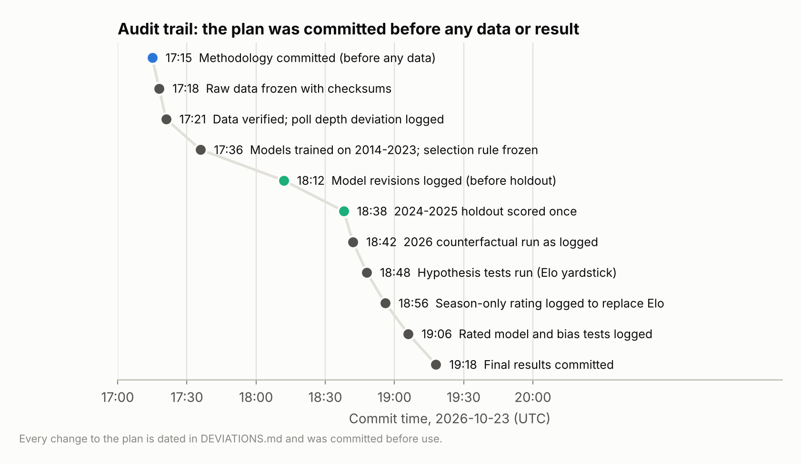

*Figure 1. Audit trail. Commit times for the plan, data freeze, model training, the one-time holdout and every later analysis.*

---

## 3. Data

### 3.1 Sources

| Data | Source | Seasons | Notes |
| --- | --- | --- | --- |
| Game results, venue, conference, Elo | [sportsdataverse/cfbfastR-data](https://github.com/sportsdataverse/cfbfastR-data), `schedules/parquet`, commit `09f2595e` | 2014–2026 | Elo used only as a comparison, never as a model input |
| AP Top 25, weekly, with points and first-place votes | [CollegeFootballData.com](https://collegefootballdata.com) API, `/rankings` | 2014–2026 | Regular season and postseason |

All 39 raw files were pulled once (2026-10-23 17:18 UTC), saved unmodified, and checksummed in `data/MANIFEST.json`. No file was re-pulled.

### 3.2 Scope and construction

- **Seasons:** training 2014–2023 (nine seasons; 2020 excluded for COVID scheduling); holdout 2024–2025; counterfactual 2026 through poll 8 (seven completed weeks).
- **Unit of analysis:** one row per FBS team per poll transition. Schedule week *w* links AP poll *w* (released before week *w*'s games; week 1 is the preseason poll) to poll *w*+1. That gives 21,626 team-weeks: 16,610 training, 4,050 holdout and 966 for 2026.
- **Conferences:** each team is tagged with its conference in that season, so realignment is handled. Five groups are used: SEC, ACC, Big Ten, Big 12, and Other (Pac-12, Group of 5, independents).
- **Checks:** every AP-ranked school in every season matched a schedule team. Tests confirm no feature uses information from after the poll it predicts (12 tests, all passing).

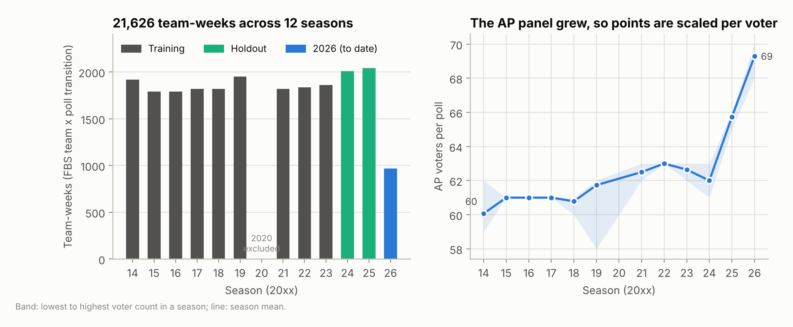

*Figure 2. Team-weeks per season by role (left) and AP voters per poll (right). The growing panel is why points are scaled per voter.*

### 3.3 Data limitations found and handled

1. **Polls stop at #25.** The API omits "others receiving votes". Points for teams ranked #26 and below are unknown, not zero. The registered rule (unranked = 0) is primary. A sensitivity rule (unranked = half of that week's #25 total) is reported alongside.
2. **The panel grew** from about 58–63 voters (2014–2023) to about 66 (2025) and 69–70 (2026). Points were converted to points per voter (voters counted as total first-place votes) so seasons are comparable.
3. **Week 0 games** are labelled week 1 in the source, and postseason games share week numbers with regular-season ones. Week-0 and week-1 games are combined; postseason games are excluded.
4. **One game was played after the poll it would have fed.** The 2019 Army–Navy game came after the final regular-season poll. A kickoff cutoff (Tuesday noon US Eastern after the week's busiest day) removed it and no other game.

---

## 4. Methods

### 4.1 Target and inputs

The target is a team's change in AP points (per voter, after revision) from poll *w* to poll *w*+1. Three input specifications were trained. None contains team names or conferences.

| Specification | Inputs | Status |
| --- | --- | --- |
| Registered | Prior poll points, opponent's poll points, win/loss/bye, points for and against, margin, home/away/neutral, number of higher-ranked teams that lost, week | As pre-registered |
| Revised | Registered inputs in points per voter, plus wins, losses and mean margin to date | Logged before the holdout |
| Rated | Revised inputs, plus the team's and its opponents' season-only strength rating (§4.4) | Logged after the holdout; holdout re-used |

### 4.2 Models, validation and selection

- **Models:** a naive baseline (predict no change), ordinary least squares, and a gradient-boosted tree challenger (scikit-learn `HistGradientBoostingRegressor`, 300 iterations, learning rate 0.05, fixed seed; not tuned).
- **Validation:** leave-one-season-out on the training seasons.
- **Selection rule (pre-registered):** use the challenger only if its holdout mean absolute error is more than 10% below the linear model's.
- **Pass criteria (pre-registered):** the chosen model beats the baseline on holdout error, *and* a replay of each holdout season reaches Spearman ρ ≥ 0.70 against the real final regular-season poll. If it fails, the counterfactual is not run.

### 4.3 Season replay

Starting from the real preseason poll, each week every team plays its real games. The model's own previous output (not the real poll) supplies prior points, opponents' points and higher-ranked losses. Teams outside the simulated top 25 take the unranked value.

- **Accuracy** is ρ over the real final top 25, using each team's simulated rank among all FBS teams.
- **Stickiness** is the mean number of places the replay holds preseason-ranked teams above their real final rank (unranked = 26).

### 4.4 Season-only strength rating

Elo carries a fixed share of the previous season. In this data a team's preseason Elo equals 1500 + 0.67 × (last season's final Elo − 1500), correlation 0.99 over 1,306 team-seasons. Any head start a conference brings into a season is therefore partly built into Elo, which makes Elo unable to detect it. We built a rating from the current season's games only, recomputed each week, with every team starting equal:

1. **Results component (Colley method):** solve *C r = b*, where *C*ᵢᵢ = 2 + games played, *C*ᵢⱼ = −(games between *i* and *j*), and *b*ᵢ = 1 + (wins − losses)/2. Opponents' results, and their opponents' results, enter through the joint solution.
2. **Performance component:** least squares on capped margin (±28 points) = *r*_home − *r*_away + *h* · home, with a home edge *h* estimated from the data. One zero-margin pseudo-game per team against an average opponent shrinks early ratings toward average.
3. **Combined rating:** the 50/50 average of the two components, each standardized across FBS teams. All FCS opponents are pooled as one team.

The weights, the cap and the shrinkage were fixed before any rating was computed.

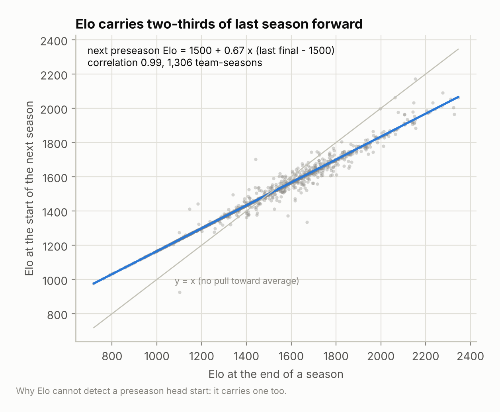

*Figure 3. Elo at the end of one season against Elo at the start of the next. Elo keeps two-thirds of last season's distance from average.*

### 4.5 Hypothesis tests

All on real 2014–2025 data. The 95% intervals come from 1,000 bootstrap resamples of whole team-seasons (seed 0).

| Test | Question | Measure |
| --- | --- | --- |
| H1 Conference effect (registered) | Same result, more points for the SEC? | SEC − ACC coefficient in the linear model with conference flags |
| H2 Poll vs strength (registered) | Is the SEC ranked above its strength? | Strength rank − AP rank, by conference (Elo, then the season-only rating, polls 6+) |
| H3 Preseason carry-over | Does preseason standing persist at equal performance? | Coefficient on preseason points, controlling record, margin, strength and week; SEC/ACC interactions |
| H4 Rewards and punishments | Are SEC wins rewarded more, losses punished less? | Out-of-season residuals of the name-blind rated model, ranked teams, after wins and after losses |
| H5 Schedule inflation | Does the poll overstate SEC schedules? | Schedule rank by opponents' poll points vs by opponents' season-only rating |
| H6 Elo head start | Does Elo carry an SEC advantage? | Season-only rank − Elo rank, by conference |

### 4.6 Counterfactual

The 2026 preseason poll is rewritten with SEC and ACC slots exchanged, and the season is replayed with real results.

- **Primary pairing:** the three ranked ACC teams swap with the top three SEC teams.
- **Extension:** all nine ranked SEC slots go to ACC teams; unranked teams are ordered by preseason Elo, used for pairing only.
- **Effect:** each team's simulated rank with the swap versus without it.
- **Yardstick:** gains no larger than the model's measured stickiness are treated as indistinguishable from model inertia.
- **Plausibility check (fixed before the rated re-run):** no Power-4 team at 6-1 or better (or 5-0) may be left unranked, and no team with three or more losses may be ranked. In 2014–2025, real voters broke these rules in 0 of 95 and 1 of 816 cases respectively.

---

## 5. Results

### 5.1 Model accuracy on training seasons

Mean absolute error per team-week, leave-one-season-out, unranked = 0:

| Specification | Baseline | Linear | Boosted trees | Ranked teams: baseline / trees |
| --- | --- | --- | --- | --- |
| Registered (AP points) | 34.6 | 60.3 | **16.8** | 157.4 / 48.9 |
| Revised (points per voter) | 0.56 | 0.98 | **0.25** | 2.56 / 0.78 |
| Rated (points per voter) | 0.56 | 0.97 | **0.24** | 2.56 / 0.77 |

The linear model is worse than predicting no change in every specification. Voter response is strongly non-linear (a win matters far more to a ranked team than to an unranked one), and a linear model cannot represent that. One rank position is about 0.80 points per voter.

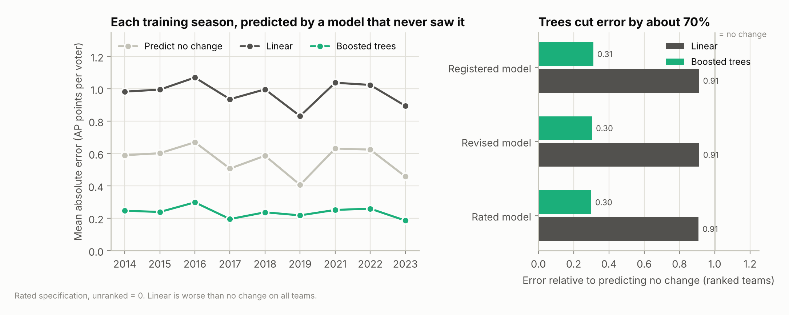

*Figure 4. Out-of-season error on each training season (left) and error relative to predicting no change for ranked teams (right).*

Season replay on training seasons (each season predicted by a model that never saw it):

| Specification | Mean ρ | Min ρ | Seasons ≥ 0.70 | Final top-25 overlap | Stickiness (places) |
| --- | --- | --- | --- | --- | --- |
| Preseason poll held fixed | 0.56 | | | | |
| Registered | 0.78 | 0.59 | 7 / 9 | 16.8 | +1.24 |
| Revised | 0.85 | 0.74 | 9 / 9 | 17.8 | +0.75 |
| Rated | **0.88** | **0.77** | **9 / 9** | **19.0** | **+0.58** |

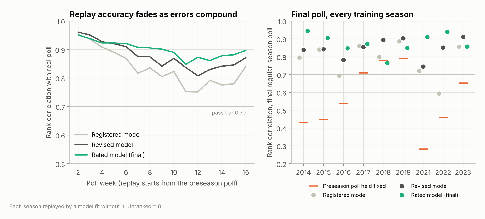

*Figure 5. Season replay on training seasons: accuracy by poll week (left) and final-poll accuracy per season against the preseason poll held fixed (right).*

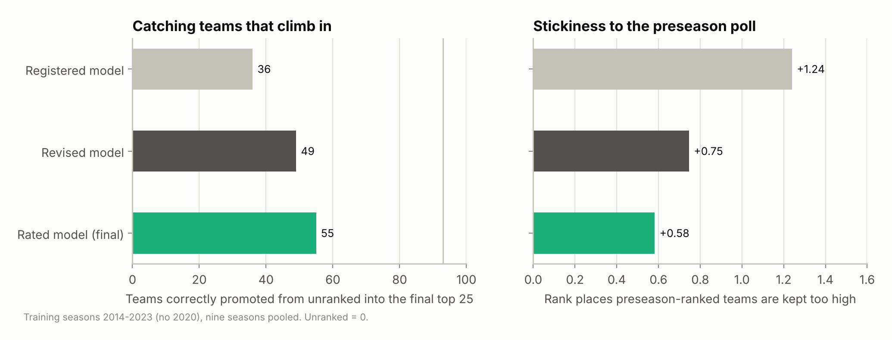

*Figure 6. Teams correctly promoted into the final top 25 from outside the preseason poll (left) and stickiness to the preseason poll (right).*

### 5.2 Holdout (2024–2025, scored once)

| Specification | Rule | Trees MAE (baseline) | ρ 2024 | ρ 2025 | Result |
| --- | --- | --- | --- | --- | --- |
| **Revised, unranked = 0 (primary)** | 0 | 0.24 (0.51) | **0.80** | **0.92** | **Pass** |
| Revised | floor | 0.37 (0.69) | 0.81 | 0.87 | Pass |
| Registered | 0 | 16.6 (32.7) | 0.73 | 0.84 | Pass |
| Registered | floor | 24.8 (43.8) | **0.62** | 0.94 | **Fail** |
| Rated (holdout re-used, not a clean test) | 0 | 0.22 (0.51) | 0.95 | 0.92 | — |

The pre-registered rule selected the boosted trees in every case. For reference, the preseason poll held fixed gives ρ = 0.64 (2024) and 0.69 (2025). Against the post-bowl final poll, which the replay does not model, the primary model reaches 0.70 and 0.87.

On the holdout, the primary model's typical weekly miss for a ranked team was 0.68 rank positions, and it called the direction of movement correctly 93% of the time. Its stickiness was higher than on training seasons (+1.72 and +2.16 places): it missed several risers from outside the preseason poll, such as Boise State, SMU and Army in 2024 and BYU, James Madison and North Texas in 2025.

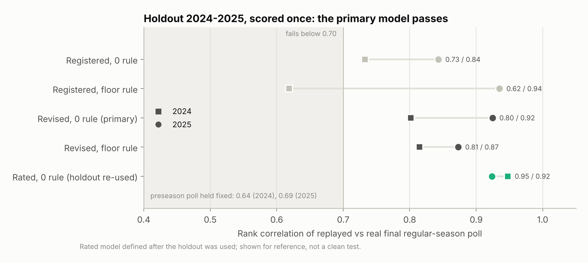

*Figure 7. Holdout replay accuracy for each specification and unranked rule, 2024 and 2025. The shaded region fails the pre-registered bar.*

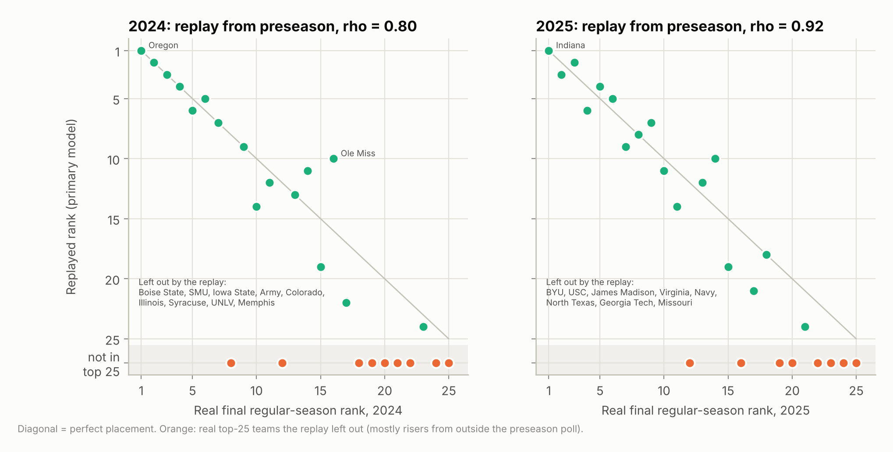

*Figure 8. Primary model, holdout replay: real final rank against replayed rank. Orange teams were in the real top 25 but not the replay's.*

### 5.3 The season-only rating

Accuracy at picking the winners of week-6-and-later FBS games, 2014–2025, from ratings through the previous week:

| Predictor | All games (n = 5,320) | Games with a ranked team (n = 1,769) |
| --- | --- | --- |
| **Season-only rating (combined)** | **70.0%** | **75.3%** |
| Results component only | 68.4% | 74.2% |
| Performance component only | 71.2% | 76.4% |
| Elo (uses prior season) | 70.2% | 75.9% |
| AP poll (better-ranked team) | — | 75.2% |

The rating matches Elo and the AP poll while using no prior-season information. The performance component alone predicts best, but the pre-set 50/50 blend was kept.

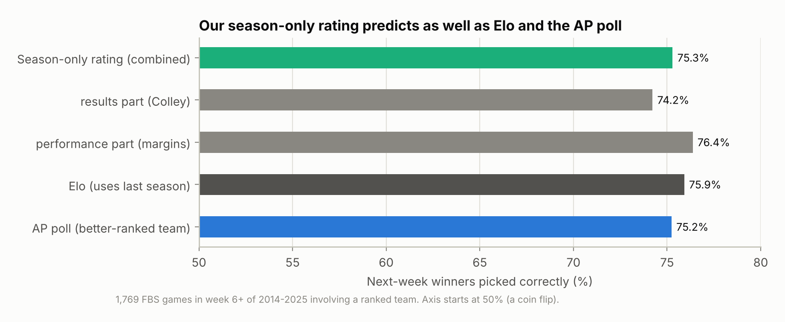

*Figure 9. Next-week winner picks in games with a ranked team, 2014–2025, week 6 and later.*

### 5.4 Hypothesis tests

**H1 — Conference effect, same result.** In the linear model, SEC teams gain 0.12 points per voter more than ACC teams for an identical result (95% CI 0.0001 to 0.24). The registered specification gives +7.3 AP points (CI 0.6–14.8). The SEC, Big Ten and Big 12 coefficients are nearly equal; the ACC's is lower. This rests on the linear model, which fits poorly (§5.1), and H4, using the far better model, does not reproduce it.

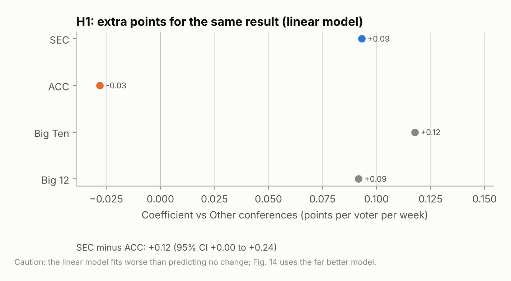

*Figure 10. H1: conference coefficients in the linear model, relative to other conferences.*

**H2 — Poll rank versus strength rank** (positive = the poll ranks a team above its strength):

| Conference | vs Elo, all polls | vs season-only rating, polls 6+ | AP-ranked but outside rating top 25 | In rating top 25 but AP-unranked |
| --- | --- | --- | --- | --- |
| **SEC** | +0.20 (−0.79, +1.27) | **+1.11 (+0.34, +1.88)** | 77 | 38 |
| **ACC** | **+1.38 (+0.06, +2.56)** | +0.35 (−0.53, +1.16) | 60 | 50 |
| Big Ten | **−1.85 (−3.06, −0.63)** | −0.87 (−1.75, +0.01) | 39 | 63 |
| Big 12 | +0.07 (−1.64, +1.78) | +1.15 (−0.19, +2.50) | 55 | 22 |
| Other | +0.02 (−1.00, +1.11) | **−0.92 (−1.78, −0.12)** | 138 | 194 |
| **SEC − ACC** | −1.18 (−2.72, +0.57) | +0.76 (−0.43, +1.93) | | |

Counts are team-weeks. The two yardsticks disagree, and the disagreement is informative (see H6). Against current-season results, the SEC is ranked about one position too high, clearly different from zero. The ACC is not distinguishable from zero. The SEC-minus-ACC difference is positive but its interval includes zero.

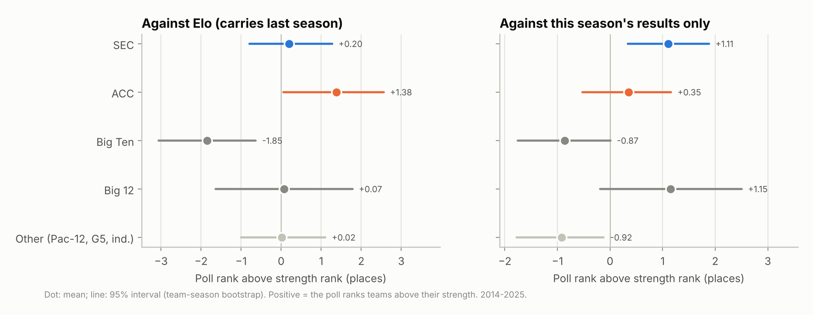

*Figure 11. H2: poll rank minus strength rank by conference, against Elo (left) and against the season-only rating (right), with 95% intervals.*

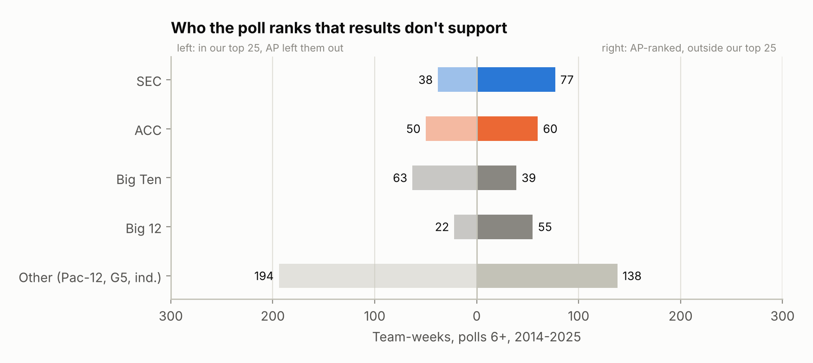

*Figure 12. H2: team-weeks ranked by the AP but outside the season-only top 25 (right), and the reverse (left).*

**H3 — Preseason carry-over.** Holding record, margin, strength and week fixed, a team's points per voter in polls 6 and later rise by 0.48 for each point per voter it held in the preseason poll (CI 0.42–0.54; with Elo as the control, 0.52, CI 0.45–0.58). Extra carry-over for the SEC relative to the ACC is +0.04 (CI −0.16 to +0.24). Preseason standing is sticky, equally so for both conferences.

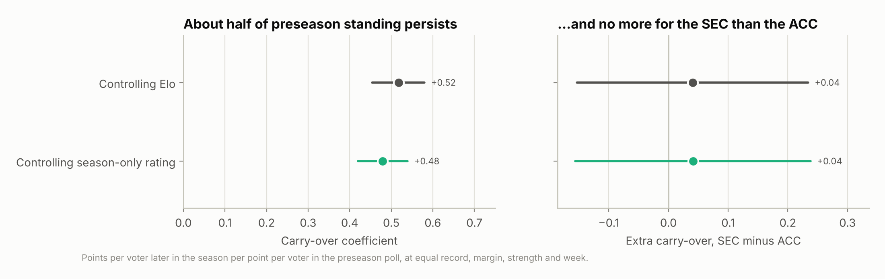

*Figure 13. H3: preseason carry-over at equal record, margin, strength and week (left), and the SEC-minus-ACC difference (right).*

**H4 — Rewards and punishments.** Residuals of the name-blind rated model for ranked teams, in points per voter (positive = rose more, or fell less, than results explain):

| Conference | After a win | After a loss | All weeks |
| --- | --- | --- | --- |
| SEC | +0.02 (−0.06, +0.09) | +0.03 (−0.16, +0.23) | +0.04 (−0.03, +0.12) |
| ACC | +0.09 (−0.04, +0.23) | −0.06 (−0.24, +0.14) | +0.06 (−0.03, +0.15) |
| Big Ten | −0.04 (−0.13, +0.07) | −0.19 (−0.47, +0.06) | −0.07 (−0.16, +0.02) |
| Big 12 | **+0.18 (+0.08, +0.30)** | −0.10 (−0.32, +0.16) | +0.08 (−0.03, +0.19) |
| Other | −0.06 (−0.17, +0.04) | −0.13 (−0.30, +0.05) | −0.07 (−0.15, +0.00) |
| **SEC − ACC** | −0.07 (−0.23, +0.09) | +0.09 (−0.20, +0.37) | −0.01 (−0.13, +0.11) |

Once opponent quality is measured by results rather than by poll standing, voters treat SEC and ACC results the same. The only clear conference effect is a reward for Big 12 wins.

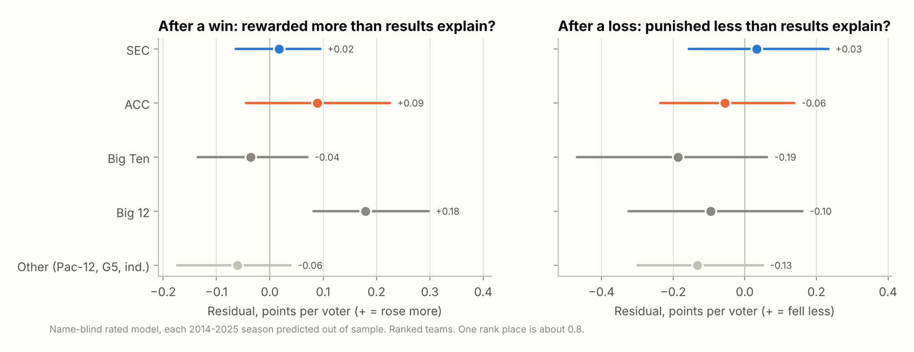

*Figure 14. H4: how far ranked teams beat the name-blind model after wins (left) and losses (right), by conference.*

**H5 — Schedule inflation.** Each team-season's schedule is ranked among FBS teams (1 = toughest) by opponents' poll points and by opponents' season-only rating:

| Conference | Mean rank by poll | Mean rank by results | Inflation (rating rank − poll rank) |
| --- | --- | --- | --- |
| **SEC** | 22 | 29 | **+6.7 (+3.9, +9.4)** |
| **ACC** | 52 | 45 | **−7.0 (−10.3, −3.7)** |
| Big Ten | 33 | 29 | −4.5 (−7.3, −1.7) |
| Big 12 | 41 | 40 | −1.6 (−6.4, +3.7) |
| Other | 84 | 88 | +4.2 (+2.5, +5.7)* |
| **SEC − ACC** | | | **+13.7 (+9.1, +17.9)** |

\*The Other figure is sensitive to ties at zero (teams that faced no ranked opponent); with average ranks it is +1.3. The SEC (+6.7) and ACC (−7.2) figures are not sensitive to this.

This is the largest and most precisely estimated effect in the study. The poll makes SEC schedules look about seven places tougher, and ACC schedules about seven places easier, than opponents' actual results justify. In 2026 to date the direction is the same but the estimate is imprecise: SEC +2.7 (−3.2, +9.3), ACC −4.9 (−14.9, +4.0), SEC − ACC +7.6 (−3.6, +19.7).

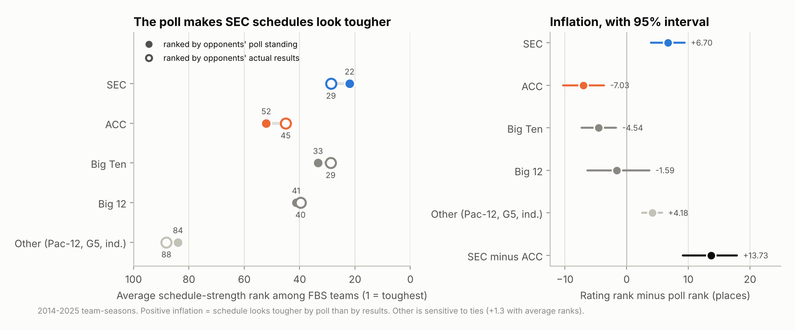

*Figure 15. H5: average schedule rank by opponents' poll standing (filled) and by their actual results (open), left; inflation with 95% intervals, right.*

**H6 — Elo's head start.** Relative to the season-only rating (polls 6+), Elo ranks SEC teams 0.91 places higher (−0.48, +2.18) and ACC teams 1.07 places lower (−2.55, +0.48). The SEC − ACC difference is **+1.98 (+0.03, +3.86)**. Elo carries roughly two positions more prior-season advantage for the SEC than for the ACC. That explains why the Elo-based version of H2 showed no SEC overrating: Elo shares part of the head start the test was looking for.

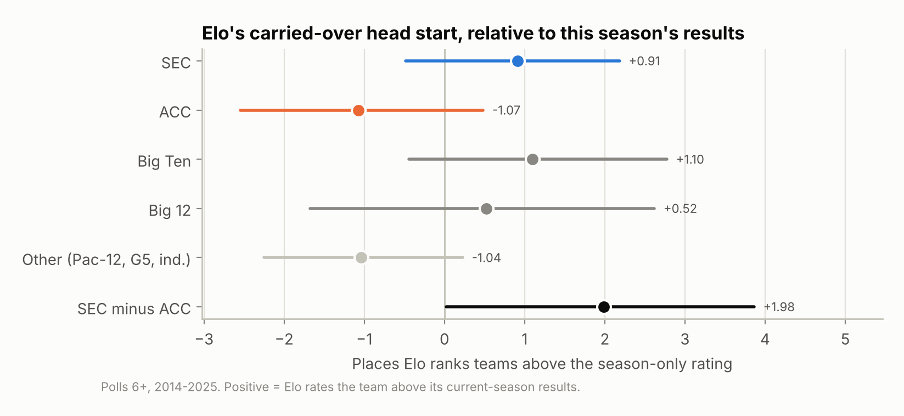

*Figure 16. H6: places Elo ranks teams above the season-only rating, by conference.*

### 5.5 What real voters do at poll 8 (2014–2025)

These counts use no model.

| Situation after seven weeks | Team-seasons | Ranked in poll 8 |
| --- | --- | --- |
| Power-4, 6-1 or better, started unranked | 30 | 100% |
| Power-4, 6-1 or better, started ranked | 65 | 100% |
| Power-4, 5-1 or better, started unranked | 73 | 75% |
| Power-4, 5-1 or better, started ranked | 107 | 100% |
| Started top 12, three or more losses | 18 | 6% |
| Started 13–25, three or more losses | 45 | 0% |

A strong record overrides preseason rank. At 5-1, teams that started ranked are always ranked, while a quarter of unranked starters are not. That gap is consistent with H3. It is not by itself evidence of bias, because teams that start ranked are usually stronger.

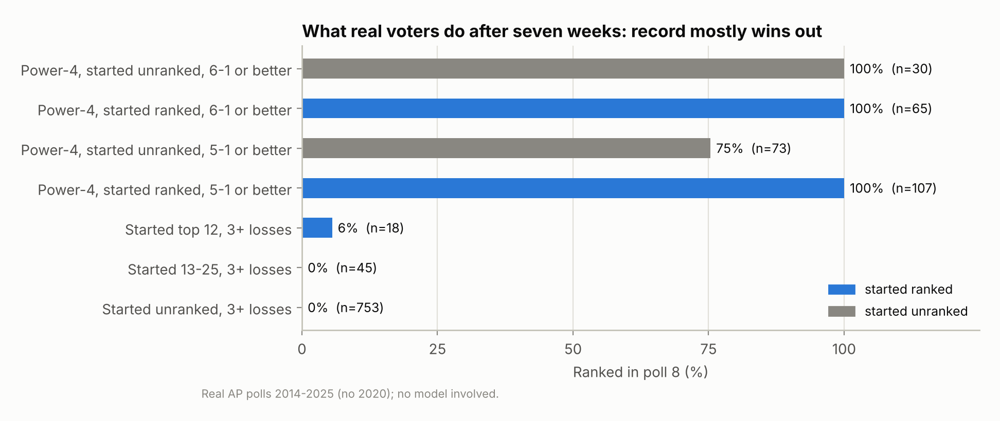

*Figure 17. Share of teams ranked in poll 8 by record and preseason status, real AP polls 2014–2025.*

### 5.6 The 2026 counterfactual

The 2026 preseason poll ranked nine SEC teams and three ACC teams (Miami #7, SMU #19, Louisville #24). Top-25 slots by conference at poll 8, unranked = 0:

| Run | Model | SEC | ACC | Big Ten | Big 12 | Other | Plausibility check |
| --- | --- | --- | --- | --- | --- | --- | --- |
| Real AP poll | — | 9 | 3 | 6 | 5 | 2 | Passes |
| No swap (sanity) | Rated | 9 | 2 | 8 | 5 | 1 | Fails |
| Three pairs swapped | Rated | 10 | 2 | 8 | 4 | 1 | Fails |
| Nine slots swapped | Rated | 6 | 5 | 8 | 5 | 1 | Fails |
| No swap (sanity) | Revised | 9 | 2 | 9 | 4 | 1 | Fails |
| Nine slots swapped | Revised | 5 | 7 | 7 | 5 | 1 | Fails |

- **Sanity run.** With the rated model and no swap, the simulated poll agrees with the real one well (ρ = 0.92; 21 of 25 teams shared).
- **Primary three-pair swap.** SMU (5-1) rises from a simulated #23 to #12 with Texas's preseason slot. Texas falls from #24 to unranked. Miami and Georgia change little.
- **Nine-slot extension.** Larger moves follow: Louisville +13, Virginia +10, Pittsburgh +9; Tennessee −16, Alabama −11, LSU −8.
- **Plausibility.** Every run fails, including the sanity run. The model leaves 6-1 Wake Forest unranked (real #17) and keeps 3-3 Oklahoma ranked (real: unranked). The nine-slot swaps add further violations: 6-1 Tennessee unranked, and 4-3 Virginia, Louisville and others ranked. The real 2026 poll passes the same check.

These swap results reflect the model's attachment to starting position more than voter behavior, and are not used as evidence.

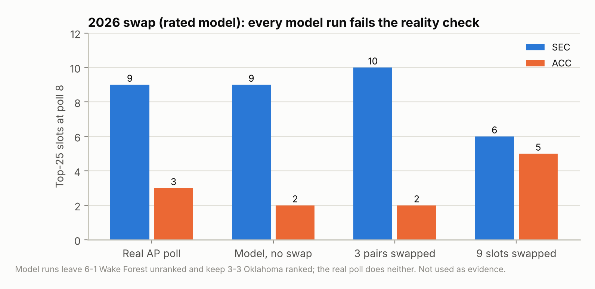

*Figure 18. 2026 top-25 slots by conference at poll 8: the real poll and the rated model's runs.*

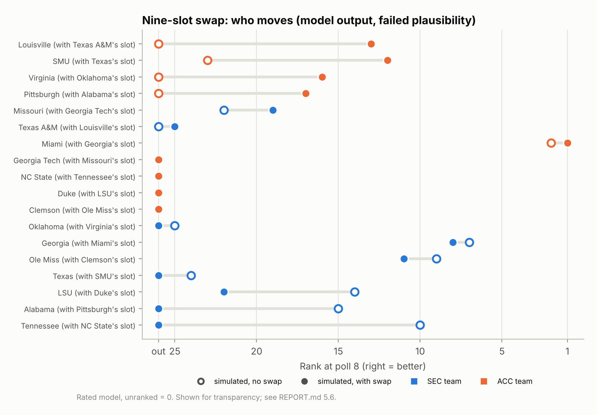

*Figure 19. Nine-slot swap, rated model: each paired team's simulated rank without and with the swap.*

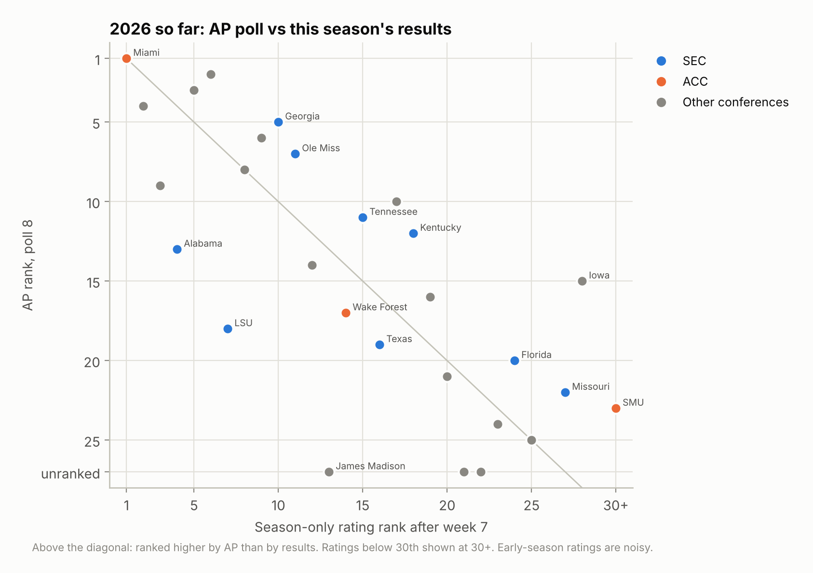

*Figure 20. 2026 to date: AP rank in poll 8 against the season-only rating after week 7.*

### 5.7 Exploratory team-level residuals

`src/team_bias.py` (not pre-registered) lists teams the model consistently over- or under-predicts. With the revised model on training seasons, conference averages for ranked teams are SEC +0.06, ACC +0.05, Big Ten −0.05 and Big 12 +0.07 points per voter. The only clear conference result is the Big 12 after wins (+0.19), consistent with H4. Team-level lists involve about 70 teams × 3 situations, so some flagged results are expected by chance.

---

## 6. Deviations from the pre-registered plan

Every entry is dated in `DEVIATIONS.md` and was committed before use. The last column states what had been seen when each decision was made.

| # | Change | Reason | Decided after seeing |
| --- | --- | --- | --- |
| 1 | Unranked = 0 kept as primary; floor rule added as sensitivity | API lists only the top 25 | Data only |
| 2 | Week-0 games combined, postseason excluded, FCS games counted | Source labelling | Data only |
| 3 | Games after the poll they would feed dropped | Leakage test found 2019 Army–Navy | A failing test |
| 4 | Replay mechanics and pass-test details fixed | Methodology left them open | Nothing beyond training data |
| 5 | Points per voter; season-to-date record as inputs | Replay was too sticky; panel grew | Training-season results |
| 6 | Stickiness yardstick set from the holdout (larger value) | Holdout stickiness exceeded training | Holdout results |
| 7 | Swap pairing (three pairs primary, nine-slot extension) | Nine SEC vs three ACC teams ranked in 2026 | 2026 preseason poll only |
| 8 | Post-hoc plausibility check (base rates) | Swap produced implausible rankings | Counterfactual results |
| 9 | Hypothesis test definitions, including H3 | Methodology left details open | Base rates |
| 10 | Season-only rating replaces Elo as the primary yardstick; Elo kept for comparison | Elo carries 67% of the prior season | Elo-based hypothesis results |
| 11 | Rated model; H4–H6; swap re-run with a pre-set plausibility check | Opponent strength measured by poll standing alone carries the effect under test | Season-rating results |

Deviations 5, 6, 8, 10 and 11 were made after some results were known. None changed how the holdout was scored. Results under the original specifications are reported alongside wherever they exist, and the original Elo-based results remain in `results/hypothesis.json`.

---

## 7. Discussion

### 7.1 Against the pre-registered criteria

| Criterion | Result | Verdict |
| --- | --- | --- |
| Swap lifts ACC teams substantially | ACC teams rise in every swap run, but every run, including the no-swap run, fails the plausibility check | Not established |
| SEC poll standing above independent strength | Above the season-only rating (+1.1, CI excludes zero); not above Elo, which shares the head start (H6) | Supported, with caveats |
| SEC poll standing matches strength (refutation) | Matches Elo; does not match current-season results | Not met |

By the letter of the pre-registration, the claim is neither confirmed (the swap evidence is unusable) nor refuted (the SEC is ranked above its current-season strength).

### 7.2 What the evidence shows

The study distinguishes three mechanisms by which the SEC could benefit:

1. **Voters score SEC games more generously.** Not supported. For the same result against the same quality of opponent, SEC and ACC teams move alike (H4). The H1 result pointing the other way comes from a model that fits worse than predicting no change.
2. **Preseason standing persists, and the SEC starts with more of it.** Supported, but the effect is general. About half of preseason standing persists into mid-season at equal performance, for every conference alike (H3). The SEC benefits because it begins with more ranked teams, not because its rankings are stickier.
3. **The poll inflates the perceived strength of SEC schedules.** Strongly supported. SEC opponents are ranked well above what their results justify, so SEC schedules look about seven places tougher than they are, while ACC schedules look about seven places easier (H5). This is the mechanism in the original claim, and it is the clearest and most precisely measured effect in the study.

The net result is that SEC teams sit about one position above what their current-season results support (H2). The Big 12 shows a similar overrating, and Group of 5 teams are underrated by about the same amount, so this is not unique to the SEC.

### 7.3 On the ACC

The ACC's own teams are not ranked below their current-season strength (H2: +0.35, not distinguishable from zero), and voters do not punish ACC results more (H4). The ACC's disadvantage is indirect: its opponents are ranked below their results, so ACC teams receive less credit for whom they played. Whether ACC teams with SEC-like preseason positions would be ranked as highly could not be answered reliably (§5.6).

### 7.4 On Elo

Elo is independent of voters but not of the previous season. Its season-to-season carry-over (0.67) gives the SEC about two positions more head start than the ACC relative to current-season results (H6). Comparisons against Elo therefore understate any advantage the SEC carries from prior reputation. That is why the Elo-based test (H2, first column) found no SEC overrating while the current-season test did.

---

## 8. Limitations

1. **Voter behavior, not team quality.** The models describe how voters react to results. The season-only rating is a measure of performance, not a definitive measure of quality.
2. **The season-only rating uses scores only.** It ignores injuries, quarterback changes and other information voters may legitimately use, and some apparent "overrating" may reflect that information. Its blend weight and margin cap were fixed in advance but are choices. It is noisy before week five, so H2–H4 that use it are restricted to polls 6 and later.
3. **Missing votes below #25.** All points-based quantities treat teams outside the top 25 as unranked. Results are reported under two rules and are similar.
4. **The counterfactual is not credible.** Even the best model is stickier than real voters, and every swap run fails a plausibility check that the real poll passes. The counterfactual also assumes games would end with the same scores regardless of rankings.
5. **The holdout was used once for the registered and revised models.** The rated model was defined afterwards, and its 2024–2025 numbers are labelled as a re-used holdout.
6. **Several analyses were added after earlier results were seen** (§6). Each was logged before it was run, and its timing is disclosed. Readers should weigh these as less confirmatory than the pre-registered tests.
7. **Multiple comparisons.** Five conference groups, several situations and two unranked rules produce many intervals; a few are expected to exclude zero by chance. The headline results (H3 and H5) have intervals well clear of zero.
8. **Observational design.** Preseason rank is not randomly assigned. Controls for record, margin and strength reduce but cannot remove confounding.
9. **Single source per data type.** Results depend on the accuracy of the CFBD poll data and the cfbfastR-data schedules.

---

## 9. Conclusion

The SEC does benefit in the AP poll, but not in the way the claim most often implies. Voters do not grade SEC games more generously. Instead, preseason standing persists for every team, the SEC starts with the most of it, and the resulting rankings make SEC schedules look markedly tougher than opponents' results support. That inflated schedule strength is the clearest effect we found: about seven places for the SEC and about seven places in the opposite direction for the ACC. Its net effect is that SEC teams are ranked about one position above their current-season results, a margin shared with the Big 12. Whether ACC teams would rise to SEC-like rankings given SEC-like starting positions cannot be determined with these models, and we do not claim it.

---

## 10. Reproducibility

```bash
pip install -r requirements.txt
python run_all.py
```

`run_all.py` rebuilds every number in this report from the frozen files in `data/raw`, offline. An independent rebuild from a fresh clone of commit `ccf8b45` reproduced all 29 committed result files byte for byte, with all 12 tests passing. The same check found that a clean clone lacked the `data/processed/` folder at the second step; that was fixed in the following commit. `src/score_holdout.py` fails if the recomputed holdout differs from the recorded `results/holdout.json`. `src/pull_data.py`, the only network step, re-pulls data and needs a CollegeFootballData.com key in `CFBD_API_KEY`; running it would change the frozen inputs and must be logged.

### File map

| Result | File | Script |
| --- | --- | --- |
| Data checksums | `data/MANIFEST.json` | `src/pull_data.py`, `src/verify_data.py` |
| Training metrics, model specs | `results/train_metrics.json`, `results/model_spec.json` | `src/train.py` |
| Training-season replay | `results/replay_training.json` | `src/replay.py` |
| Holdout (once) | `results/holdout.json` | `src/score_holdout.py` |
| Rated model, holdout re-used | `results/holdout_reuse_rated.json` | `src/evaluate_rated.py` |
| Season-only rating validation | `results/season_rating_validation.json` | `src/season_rating.py` |
| H1–H3 | `results/hypothesis.json` | `src/hypothesis.py` |
| H4–H6 | `results/bias_tests.json`, `results/schedule_strength_2026.csv` | `src/bias_tests.py` |
| Real-voter base rates | `results/base_rates_poll8.json` | `src/base_rates.py` |
| Counterfactual | `results/counterfactual_2026.json`, `results/counterfactual_2026_rated.json` | `src/counterfactual.py` |
| Exploratory team residuals | `results/team_bias_*.csv`, `results/conference_bias_*.csv` | `src/team_bias.py` |
| Figures 1–20 | `results/figures/*.png` | `src/figures.py` |
