# Preseason Rank, Schedule Strength and the AP Poll: Does the SEC Benefit from Voter Bias?

**Kyle Bowlsbey** · October 23, 2026 · revised October 31, 2026
Pre-registered plan with logged deviations. The main findings come from follow-up tests added during the analysis (§6). Code, data checksums and every result: this repository.

**About this study.** Kyle is a Miami (ACC) fan, and the claim tested here is one he believed going in. The code and this report were written with Claude Code under his direction. Several analysis choices changed during the work after earlier results had been seen; each is dated in `DEVIATIONS.md` and listed in §6 with what had been seen at the time. An outside review of the first version found that the schedule result (H5) mixed a real effect with a measurement artifact; §5.4 reports the corrected analysis next to the original. Data provided by [CollegeFootballData.com](https://collegefootballdata.com) and [sportsdataverse/cfbfastR-data](https://github.com/sportsdataverse/cfbfastR-data).

---

## Abstract

We test the claim that the Southeastern Conference (SEC) appears stronger than it is because its teams start the season ranked, and that wins over ranked opponents then inflate the conference's standing. Using every regular-season AP Top 25 poll from 2014 to 2026 (2020 excluded) and every FBS game result, we (i) trained models that predict week-to-week AP poll movement from results alone, without team names or conferences; (ii) built a strength rating that uses only the current season's games; (iii) tested conference-level differences against that rating, with 95% bootstrap intervals over team-seasons; and (iv) compared the AP top 25 with a strength-of-record top 25 built from the same season's results alone, with t-intervals over seasons.

The model passed its pre-registered out-of-sample test. For the 2024 and 2025 seasons, a full replay from the preseason poll reached a rank correlation of 0.80 and 0.92 with the real final regular-season poll; the bar was 0.70.

**The registered tests gave mixed signals.** H1 (linear model) found SEC teams gain slightly more than ACC teams for the same result, but that model fits worse than predicting no change. H2 against Elo found the poll rates ACC teams above Elo and SEC teams in line with it. After seeing those Elo results we replaced Elo with a season-only rating (deviation 10), because preseason Elo is 0.67 × last season's final Elo and so carries the very head start being tested. The findings below come mostly from follow-up tests added during the analysis.

1. **Preseason standing persists for every conference** (H3, registered as defined in deviation 9). About half of it (coefficient 0.48, 95% CI 0.42–0.54) is still visible after week five, holding record, scoring margin and strength fixed. The SEC does not carry over more than the ACC: difference +0.04, 95% CI −0.16 to +0.24.
2. **For the same result against the same quality of opponent, voters do not reward SEC wins more or punish SEC losses less than ACC ones** (H4, added).
3. **SEC opponents are ranked higher on game day than their season results end up justifying** (H5 sensitivity, added). On a matched top-25 scale, SEC schedules look 5.7 places tougher among about 130 FBS teams by opponents' game-day poll rank than by opponents' final results (95% CI +2.9 to +8.9). The ACC shows no such effect (+2.1, CI −1.1 to +5.5), and the SEC-minus-ACC gap (+3.5, CI −0.8 to +8.0) is not statistically clear. As originally computed, H5 reported an ACC effect of −7.0 and a gap of 13.7 places; most of that came from scoring good-but-unranked opponents as zero on one side only.
4. **SEC teams sit about one poll position above what their current-season results support** (+1.1, 95% CI +0.3 to +1.9; H2 against the season-only rating, added). The SEC-minus-ACC difference (+0.76, CI −0.43 to +1.93) is not distinguishable from zero, and the Big 12 is similar to the SEC at +1.2.
5. **SEC preseason rankings are not unjustified** (T1, added last). SEC preseason-ranked teams finish almost exactly where their preseason rank predicts (+0.09 places, CI −1.63 to +1.89); ACC preseason picks hold up no better.
6. **The SEC's schedule boost shows no preseason link, but it is bigger than the ACC's** (T2, added last). Per game, SEC opponents look 0.6 to 1.2 places better on game day than their seasons end up, steadily through the season rather than mainly early. Measured this way, per game, the SEC-minus-ACC difference is clear in every part of the season, although the coarser schedule-rank version in point 3 is not.
7. **It is not an in-season voter loop either** (T3, added last). SEC teams that lose to ranked SEC rivals end up ranked about where their seasons finish (+0.44 places, CI −0.67 to +1.43), no differently from ACC teams. The SEC plays far more of these games, but each is judged like anyone else's.
8. **The results rating does not overrate the SEC** (T4, added last). Against outsiders, including bowls and playoff games the rating never saw, SEC teams beat its predictions by 3.35 points a game (95% CI +1.68 to +4.97), and match them against power-conference opponents (−0.22, CI −3.07 to +2.58). If anything, the rating undervalues SEC teams against outsiders.
9. **By results alone, the SEC has the most top-25 teams** (T5, added last). In a strength-of-record top 25 built only from scores and schedules (no polls, preseason or names), the SEC averages 5.5 teams per poll, the Big Ten 4.7 and the ACC 3.2 (SEC minus ACC +2.27, 95% t +1.23 to +3.31). The AP lists 0.68 more SEC teams per poll than that (polls 6+, 95% t +0.20 to +1.16), a surplus shared with the other power conferences. It is not robust: calibrated to each conference's results against outsiders, it is +0.08.
10. **Early polls list more SEC teams than finish top 25 on results, but ranked SEC teams fall out at the usual rate** (T6, added last). In polls 1–5 the AP holds 1.65 more SEC teams per poll than the end-of-season strength-of-record top 25 (95% t +0.51 to +2.80; 10 of 11 seasons), the most of any conference. At the rates seen for every team at those AP ranks, SEC teams drop out of the final top 25 as expected (+0.07 beyond expected, 95% t −0.65 to +0.78): the SEC simply has the most ranked teams. Measured in hindsight; not proof of intent.

A direct counterfactual, swapping SEC and ACC preseason positions in 2026, could not be answered reliably. Even our best model holds on to preseason rank more firmly than real voters do: it failed a plausibility check fixed in advance, which the real 2026 poll passes.

In short, the claim is partly supported. Miami's 2026 résumé holds up by results: after week 8 it is #1 by strength of record (§5.12). Rankings do flatter SEC schedules: SEC opponents are ranked about 5.7 schedule places higher on game day than their final results support, and early polls list more SEC teams than finish in the top 25 on results. But the SEC's strength is not a ranking artifact. By results alone it has the most top-25 teams, its teams beat the rating's predictions against outsiders, ranked SEC teams fall out of the top 25 at the usual rate, voters do not grade SEC games more generously, and there is no ranked "swap seats" loop. What rankings add is about one poll place, about as much as the Big 12 gets. ACC schedules are not shown to be undersold.

---

## 1. Introduction

The AP Top 25 is a weekly ranking produced by about 60–70 sportswriters and broadcasters. Each voter ranks 25 teams (25 points for first place down to 1 for 25th), and the published poll orders teams by total points. Polls begin before any game is played, so preseason expectations shape the starting point. Beating a ranked opponent is widely seen as worth more than beating an unranked one.

This creates a possible feedback loop. A conference with many preseason-ranked teams plays many "ranked" games, its winners collect credit for beating ranked teams, and the conference's perceived strength sustains itself. The claim under test is that this loop, rather than on-field strength, explains much of the SEC's reputation.

### 1.1 Pre-registered hypotheses

From `METHODOLOGY.md`, committed before any data was pulled:

- **Claim:** preseason rank, not on-field strength, drives much of the SEC's perceived schedule strength.
- **Would support the claim:** swapping SEC and ACC preseason slots moves ACC teams up substantially by late season, *and* SEC poll standing sits above an independent strength rating.
- **Would refute it:** swapped ACC teams fall back toward their real positions, *and* SEC poll standing matches the strength rating.

### 1.2 Commitments

Results were to be published whichever way they pointed, every departure from the plan logged with a date before use, and every number reproducible from one command.

---

## 2. Audit trail

The work was done on October 23 and October 31, 2026. The plan was committed before any data was pulled; each change to the plan was committed before it was used. Times are UTC and on October 23 unless marked October 31.

| Commit | Time | Event |
| --- | --- | --- |
| `cd6763d` | 17:15 | Methodology committed (first commit in the repository) |
| `17c9e98` | 17:18 | Raw data frozen with SHA-256 checksums |
| `5e20115` | 17:21 | Data verified; first deviation logged (polls list only the top 25) |
| `83f435b` | 17:36 | Models trained on 2014–2023; selection rule frozen |
| `3a0840d` | 18:12 | Model revisions logged (after training-season diagnostics, before the holdout) |
| `da787f8` | 18:38 | 2024–2025 holdout scored once |
| `db85623` | 18:42 | 2026 counterfactual run as logged |
| `4c6923a` | 18:48 | Hypothesis test run (Elo yardstick) |
| `9ab4c04` | 18:56 | Season-only rating logged as replacement yardstick |
| `595dfc5` | 19:06 | Rating-aware model, voter-bias and schedule-inflation tests logged |
| `ccf8b45` | 19:18 | First full set of results committed |
| `00df744` | 19:49 | First version of this report, with figures |
| `f016679` | 20:27 | Outside review: H5 sensitivity logged before its code |
| `3cfcd87` | 20:28 | H5 sensitivity results committed |
| `7a36795` | 20:30 | Raw-data removal logged (CFBD terms) |
| `ca87285` | 20:34 | Findings rewritten after the H5 sensitivity check |
| `6fcd9c5` | 20:37 | Single-threaded training logged (cross-machine reproducibility) |
| `8ae7ee7` | 21:50 | Exploratory 2026 over/underrated board logged before running |
| `de86193` | 21:53 | T1 and T2 logged before running |
| `89455a4` | 22:06 | T3 logged before running |
| `caf918c` | 23:18 | T4 logged before running |
| `b413b7c` | Oct 31, 17:08 | 2026 re-freeze through week 8 logged before pulling |
| `790f844` | Oct 31, 17:09 | 2026 data re-frozen through week 8 (AP poll 9); historical files unchanged |
| `7c54d87` | Oct 31, 17:15 | 2026 outputs recomputed through week 8 |
| `d608984` | Oct 31, 17:29 | T5 logged before running (code `e03ebb2`) |
| `18b25fb` | Oct 31, 17:53 | T6 logged before running, blind to T5's results (code `3643a3b`) |
| `a065488` | Oct 31, 17:54 | T6 run as logged |
| `3a01c50` | Oct 31, 17:59 | T5 run as logged |
| `7e55d24` | Oct 31, 19:44 | Corrections from an independent audit of T5 and T6 logged and coded before rerunning (no logged number changes) |

Section 6 lists every deviation and, importantly, which results had been seen when each was decided.

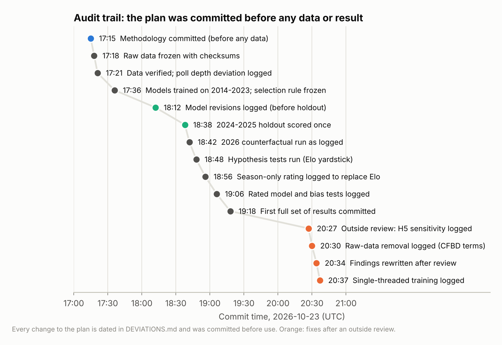

*Figure 1. Audit trail of the October 23 work: commit times for the plan, data freeze, model training, the one-time holdout and the analyses that followed. The October 31 events are in the table above.*

---

## 3. Data

### 3.1 Sources

| Data | Source | Seasons | Notes |
| --- | --- | --- | --- |
| Game results, venue, conference, Elo | [sportsdataverse/cfbfastR-data](https://github.com/sportsdataverse/cfbfastR-data), `schedules/parquet`, commit `09f2595e` (2026: `2f9c0044`) | 2014–2026 | Elo used only as a comparison, never as a model input |
| AP Top 25, weekly, with points and first-place votes | [CollegeFootballData.com](https://collegefootballdata.com) API, `/rankings` | 2014–2026 | Regular season and postseason |

All 39 raw files were pulled on 2026-10-23 (17:18 UTC), saved unmodified, and checksummed in `data/MANIFEST.json`. The three 2026 files were re-pulled once, on 2026-10-31 (17:08 UTC), to add week 8 and AP poll 9; no historical file changed (the upstream historical schedule files were checked and are byte-identical). They are not committed: CollegeFootballData.com's terms do not allow publishing stored raw API responses. `src/fetch_data.py` rebuilds them byte for byte from the sources and checks every checksum.

### 3.2 Scope and construction

- **Seasons:** training 2014–2023 (nine seasons; 2020 excluded for COVID scheduling); holdout 2024–2025; counterfactual 2026 through poll 9 (eight completed weeks; re-frozen on October 31, the week-7 versions are in git history).
- **Unit of analysis:** one row per FBS team per poll transition. Schedule week *w* links AP poll *w* (released before week *w*'s games; week 1 is the preseason poll) to poll *w*+1. That gives 21,764 team-weeks: 16,610 training, 4,050 holdout and 1,104 for 2026.
- **Conferences:** each team is tagged with its conference in that season, so realignment is handled. Five groups are used: SEC, ACC, Big Ten, Big 12, and Other (Pac-12, Group of 5, independents).
- **Checks:** every AP-ranked school in every season matched a schedule team. Tests confirm no feature uses information from after the poll it predicts (12 tests, all passing).

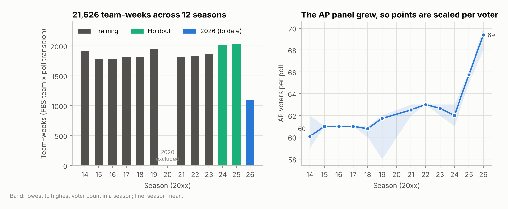

*Figure 2. Team-weeks per season by role (left) and AP voters per poll (right). The growing panel is why points are scaled per voter.*

### 3.3 Data limitations found and handled

1. **Polls stop at #25.** The API omits "others receiving votes". Points for teams ranked #26 and below are unknown, not zero. The registered rule (unranked = 0) is primary. A sensitivity rule (unranked = half of that week's #25 total) is reported alongside.
2. **The panel grew** from about 58–63 voters (2014–2023) to about 66 (2025) and 69–70 (2026). Points were converted to points per voter (voters counted as total first-place votes) so seasons are comparable.
3. **Week 0 games** are labelled week 1 in the source, and postseason games share week numbers with regular-season ones. Week-0 and week-1 games are combined; postseason games are excluded.
4. **One game was played after the poll it would have fed.** The 2019 Army–Navy game came after the final regular-season poll. A kickoff cutoff (Tuesday noon US Eastern after the week's busiest day) removed it and no other game.

---

## 4. Methods

### 4.1 Target and inputs

The target is a team's change in AP points (per voter, after revision) from poll *w* to poll *w*+1. Three input specifications were trained. None contains team names or conferences.

| Specification | Inputs | Status |
| --- | --- | --- |
| Registered | Prior poll points, opponent's poll points, win/loss/bye, points for and against, margin, home/away/neutral, number of higher-ranked teams that lost, week | As pre-registered |
| Revised | Registered inputs in points per voter, plus wins, losses and mean margin to date | Logged before the holdout |
| Rated | Revised inputs, plus the team's and its opponents' season-only strength rating (§4.4) | Logged after the holdout; holdout re-used |

### 4.2 Models, validation and selection

- **Models:** a naive baseline (predict no change), ordinary least squares, and a gradient-boosted tree challenger (scikit-learn `HistGradientBoostingRegressor`, 300 iterations, learning rate 0.05, fixed seed; not tuned).
- **Validation:** leave-one-season-out on the training seasons.
- **Selection rule (pre-registered):** use the challenger only if its holdout mean absolute error is more than 10% below the linear model's.
- **Pass criteria (pre-registered):** the chosen model beats the baseline on holdout error, *and* a replay of each holdout season reaches Spearman ρ ≥ 0.70 against the real final regular-season poll. If it fails, the counterfactual is not run.

### 4.3 Season replay

Starting from the real preseason poll, each week every team plays its real games. The model's own previous output (not the real poll) supplies prior points, opponents' points and higher-ranked losses. Teams outside the simulated top 25 take the unranked value.

- **Accuracy** is ρ over the real final top 25, using each team's simulated rank among all FBS teams.
- **Stickiness** is the mean number of places the replay holds preseason-ranked teams above their real final rank (unranked = 26).

### 4.4 Season-only strength rating

Elo carries a fixed share of the previous season. In this data a team's preseason Elo equals 1500 + 0.67 × (last season's final Elo − 1500), correlation 0.99 over 1,306 team-seasons. Any head start a conference brings into a season is therefore partly built into Elo, which makes Elo unable to detect it. We built a rating from the current season's games only, recomputed each week, with every team starting equal:

1. **Results component (Colley method):** solve *C r = b*, where *C*ᵢᵢ = 2 + games played, *C*ᵢⱼ = −(games between *i* and *j*), and *b*ᵢ = 1 + (wins − losses)/2. Opponents' results, and their opponents' results, enter through the joint solution.
2. **Performance component:** least squares on capped margin (±28 points) = *r*_home − *r*_away + *h* · home, with a home edge *h* estimated from the data. One zero-margin pseudo-game per team against an average opponent shrinks early ratings toward average.
3. **Combined rating:** the 50/50 average of the two components, each standardized across FBS teams. All FCS opponents are pooled as one team.

The weights, the cap and the shrinkage were fixed before any rating was computed.

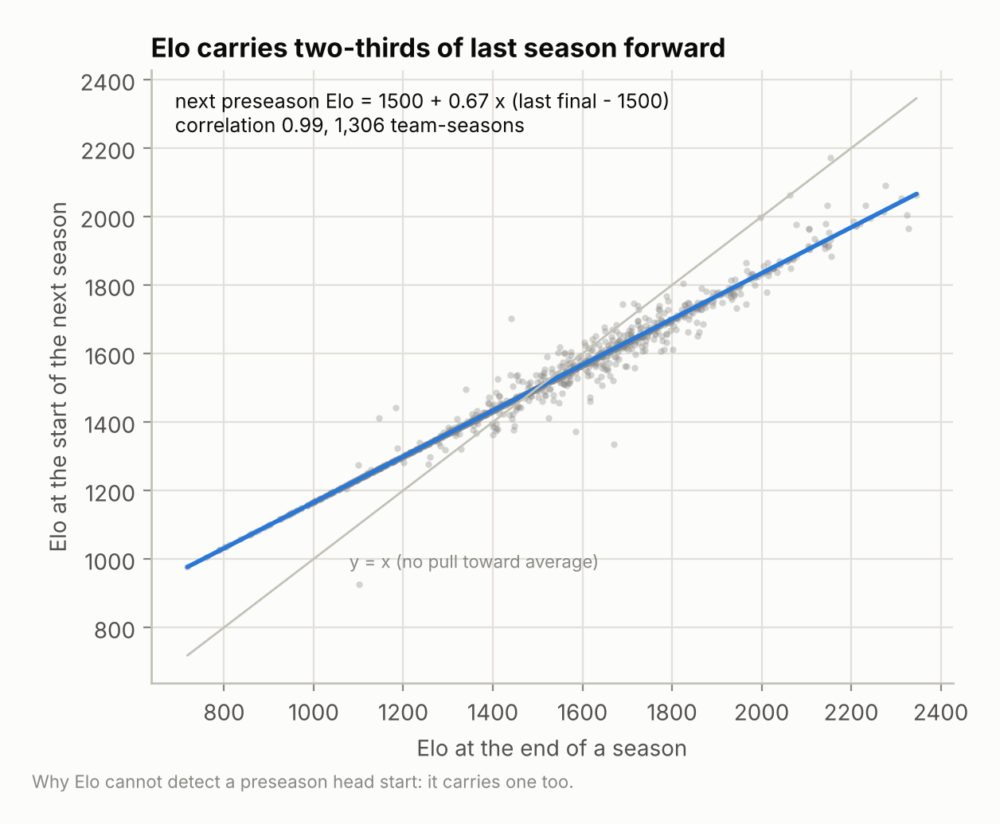

*Figure 3. Elo at the end of one season against Elo at the start of the next. Elo keeps two-thirds of last season's distance from average.*

### 4.5 Hypothesis tests

All on real 2014–2025 data. The 95% intervals come from 1,000 bootstrap resamples of whole team-seasons (seed 0).

| Test | Status | Question | Measure |
| --- | --- | --- | --- |
| H1 Conference effect | Registered | Same result, more points for the SEC? | SEC − ACC coefficient in the linear model with conference flags |
| H2 Poll vs Elo | Registered | Is the SEC ranked above its strength? | Elo rank − AP rank, by conference |
| H2 Poll vs season-only rating | Added (deviation 10) | Same question, current-season yardstick | Rating rank − AP rank, by conference, polls 6+ |
| H3 Preseason carry-over | Registered (as defined in deviation 9) | Does preseason standing persist at equal performance? | Coefficient on preseason points, controlling record, margin, strength and week; SEC/ACC interactions |
| H4 Rewards and punishments | Added (deviation 11) | Are SEC wins rewarded more, losses punished less? | Out-of-season residuals of the name-blind rated model, ranked teams, after wins and after losses |
| H5 Schedule inflation | Added (deviation 11) | Does the poll overstate SEC schedules? | Schedule rank by opponents' poll points vs by opponents' season-only rating |
| H5 sensitivity | Added (deviation 12, after outside review) | Is H5 a real effect or a measurement artifact? | H5 with shape and timing of the two measures matched (§5.4) |
| H6 Elo head start | Added (deviation 11) | Does Elo carry an SEC advantage? | Season-only rank − Elo rank, by conference |

### 4.6 Counterfactual

The 2026 preseason poll is rewritten with SEC and ACC slots exchanged, and the season is replayed with real results.

- **Primary pairing:** the three ranked ACC teams swap with the top three SEC teams.
- **Extension:** all nine ranked SEC slots go to ACC teams; unranked teams are ordered by preseason Elo, used for pairing only.
- **Effect:** each team's simulated rank with the swap versus without it.
- **Yardstick:** gains no larger than the model's measured stickiness are treated as indistinguishable from model inertia.
- **Plausibility check (fixed before the rated re-run):** no Power-4 team at 6-1 or better (or 5-0) may be left unranked, and no team with three or more losses may be ranked. In 2014–2025, real voters broke these rules in 0 of 95 and 1 of 816 cases respectively.

---

## 5. Results

### 5.1 Model accuracy on training seasons

Mean absolute error per team-week, leave-one-season-out, unranked = 0:

| Specification | Baseline | Linear | Boosted trees | Ranked teams: baseline / trees |
| --- | --- | --- | --- | --- |
| Registered (AP points) | 34.6 | 60.3 | **16.8** | 157.4 / 48.9 |
| Revised (points per voter) | 0.56 | 0.98 | **0.25** | 2.56 / 0.78 |
| Rated (points per voter) | 0.56 | 0.97 | **0.24** | 2.56 / 0.77 |

The linear model is worse than predicting no change in every specification. Voter response is strongly non-linear (a win matters far more to a ranked team than to an unranked one), and a linear model cannot represent that. One rank position is about 0.80 points per voter.

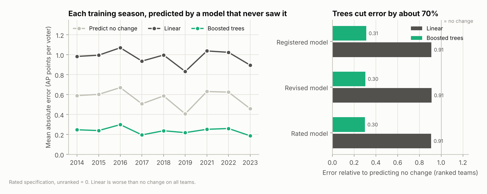

*Figure 4. Out-of-season error on each training season (left) and error relative to predicting no change for ranked teams (right).*

Season replay on training seasons (each season predicted by a model that never saw it):

| Specification | Mean ρ | Min ρ | Seasons ≥ 0.70 | Final top-25 overlap | Stickiness (places) |
| --- | --- | --- | --- | --- | --- |
| Preseason poll held fixed | 0.56 | | | | |
| Registered | 0.78 | 0.59 | 7 / 9 | 16.8 | +1.24 |
| Revised | 0.85 | 0.74 | 9 / 9 | 17.8 | +0.75 |
| Rated | **0.88** | **0.77** | **9 / 9** | **19.0** | **+0.58** |

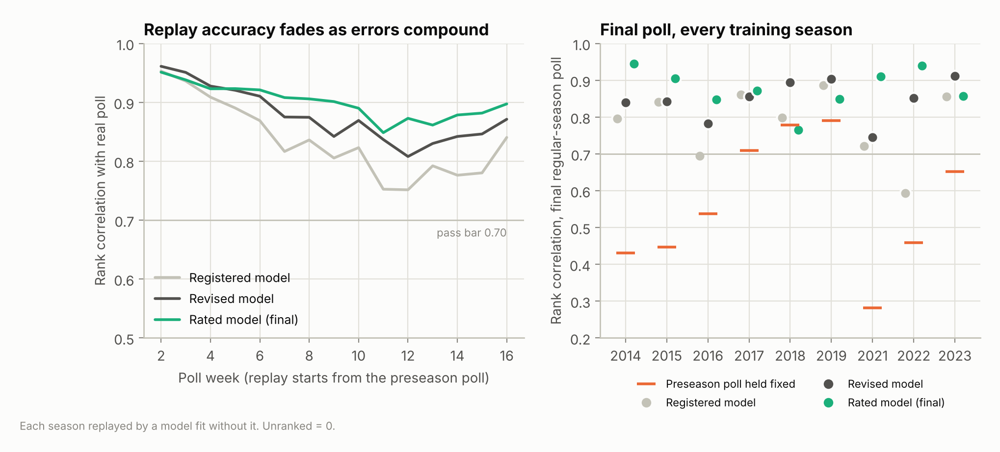

*Figure 5. Season replay on training seasons: accuracy by poll week (left) and final-poll accuracy per season against the preseason poll held fixed (right).*

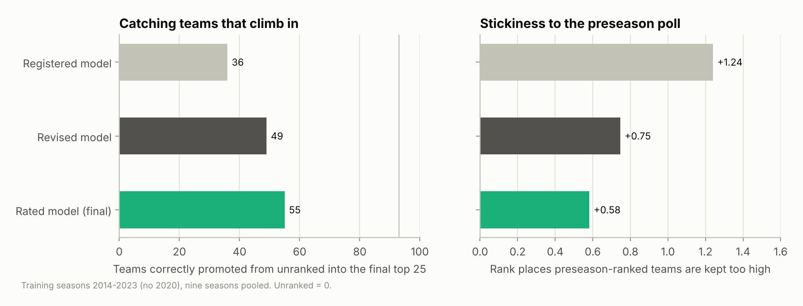

*Figure 6. Teams correctly promoted into the final top 25 from outside the preseason poll (left) and stickiness to the preseason poll (right).*

### 5.2 Holdout (2024–2025, scored once)

| Specification | Rule | Trees MAE (baseline) | ρ 2024 | ρ 2025 | Result |
| --- | --- | --- | --- | --- | --- |
| **Revised, unranked = 0 (primary)** | 0 | 0.24 (0.51) | **0.80** | **0.92** | **Pass** |
| Revised | floor | 0.37 (0.69) | 0.81 | 0.87 | Pass |
| Registered | 0 | 16.6 (32.7) | 0.73 | 0.84 | Pass |
| Registered | floor | 24.8 (43.8) | **0.62** | 0.94 | **Fail** |
| Rated (holdout re-used, not a clean test) | 0 | 0.22 (0.51) | 0.95 | 0.92 | — |

The pre-registered rule selected the boosted trees in every case. For reference, the preseason poll held fixed gives ρ = 0.64 (2024) and 0.69 (2025). Against the post-bowl final poll, which the replay does not model, the primary model reaches 0.70 and 0.87.

On the holdout, the primary model's typical weekly miss for a ranked team was 0.68 rank positions, and it called the direction of movement correctly 93% of the time. Its stickiness was higher than on training seasons (+1.72 and +2.16 places): it missed several risers from outside the preseason poll, such as Boise State, SMU and Army in 2024 and BYU, James Madison and North Texas in 2025.

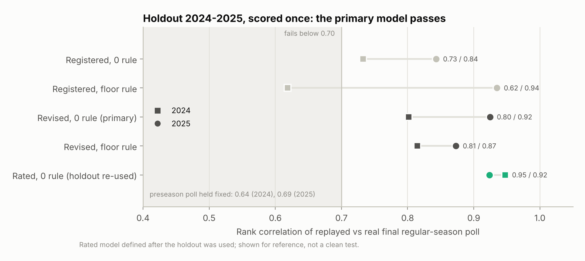

*Figure 7. Holdout replay accuracy for each specification and unranked rule, 2024 and 2025. The shaded region fails the pre-registered bar.*

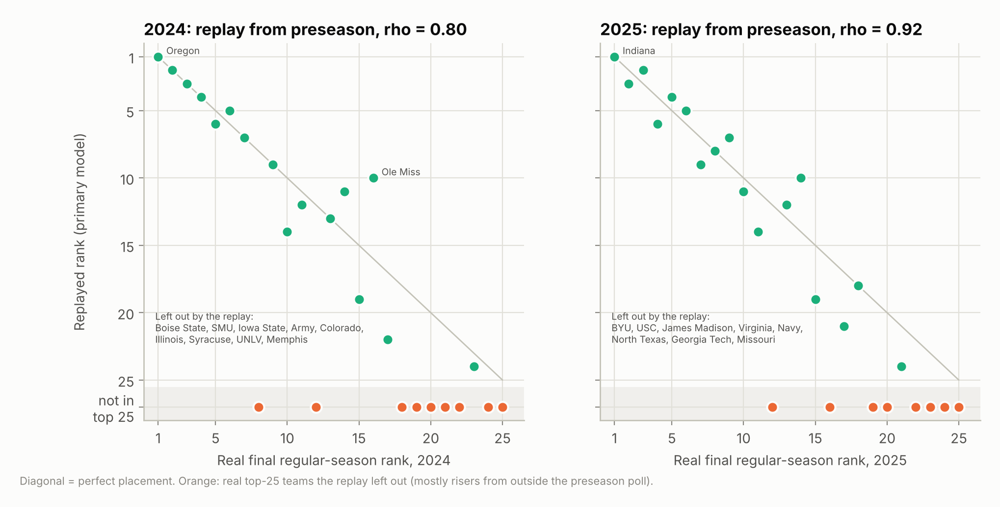

*Figure 8. Primary model, holdout replay: real final rank against replayed rank. Orange teams were in the real top 25 but not the replay's.*

### 5.3 The season-only rating

Accuracy at picking the winners of week-6-and-later FBS games, 2014–2025, from ratings through the previous week:

| Predictor | All games (n = 5,320) | Games with a ranked team (n = 1,769) |
| --- | --- | --- |
| **Season-only rating (combined)** | **70.0%** | **75.3%** |
| Results component only | 68.4% | 74.2% |
| Performance component only | 71.2% | 76.4% |
| Elo (uses prior season) | 70.2% | 75.9% |
| AP poll (better-ranked team) | — | 75.2% |

The rating matches Elo and the AP poll while using no prior-season information. The performance component alone predicts best, but the pre-set 50/50 blend was kept.

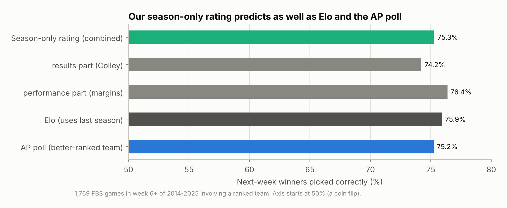

*Figure 9. Next-week winner picks in games with a ranked team, 2014–2025, week 6 and later.*

### 5.4 Hypothesis tests

**H1 — Conference effect, same result (registered).** In the linear model, SEC teams gain 0.12 points per voter more than ACC teams for an identical result (95% CI 0.0001 to 0.24). The registered specification gives +7.3 AP points (CI 0.6–14.8). The SEC, Big Ten and Big 12 coefficients are nearly equal; the ACC's is lower. This rests on the linear model, which fits poorly (§5.1), and H4, using the far better model, does not reproduce it.

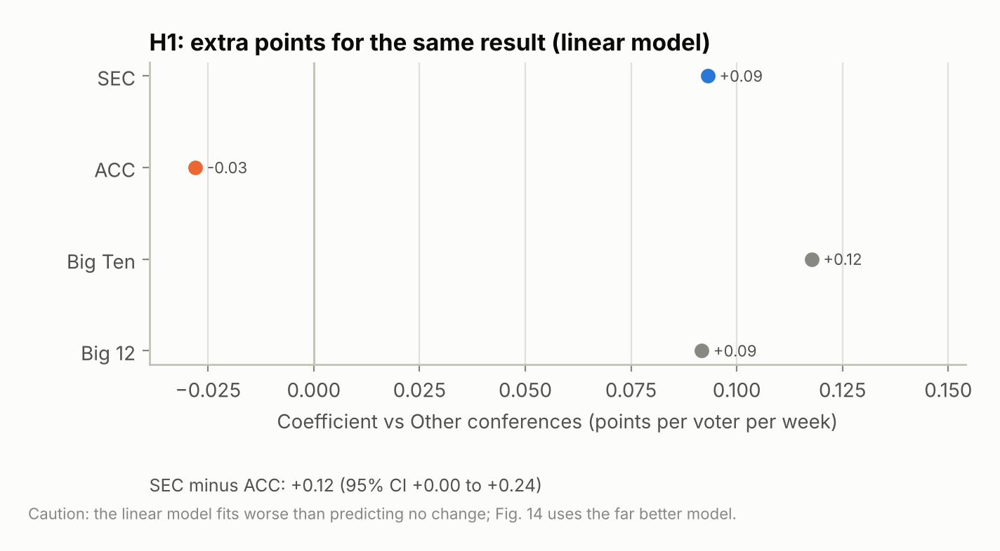

*Figure 10. H1: conference coefficients in the linear model, relative to other conferences.*

**H2 — Poll rank versus strength rank** (positive = the poll ranks a team above its strength). The Elo column is registered; the season-only column was added after the Elo results were seen (deviation 10):

| Conference | vs Elo, all polls (registered) | vs season-only rating, polls 6+ (added) | AP-ranked but outside rating top 25 | In rating top 25 but AP-unranked |
| --- | --- | --- | --- | --- |
| **SEC** | +0.20 (−0.79, +1.27) | **+1.11 (+0.34, +1.88)** | 77 | 38 |
| **ACC** | **+1.38 (+0.06, +2.56)** | +0.35 (−0.53, +1.16) | 60 | 50 |
| Big Ten | **−1.85 (−3.06, −0.63)** | −0.87 (−1.75, +0.01) | 39 | 63 |
| Big 12 | +0.07 (−1.64, +1.78) | +1.15 (−0.19, +2.50) | 55 | 22 |
| Other | +0.02 (−1.00, +1.11) | **−0.92 (−1.78, −0.12)** | 138 | 194 |
| **SEC − ACC** | −1.18 (−2.72, +0.57) | +0.76 (−0.43, +1.93) | | |

Counts are team-weeks. The two yardsticks disagree, and the disagreement is informative (see H6). Against current-season results, the SEC is ranked about one position too high, clearly different from zero. The ACC is not distinguishable from zero. The SEC-minus-ACC difference is +0.76 (CI −0.43 to +1.93), not distinguishable from zero, and the Big 12 (+1.15) is similar to the SEC.

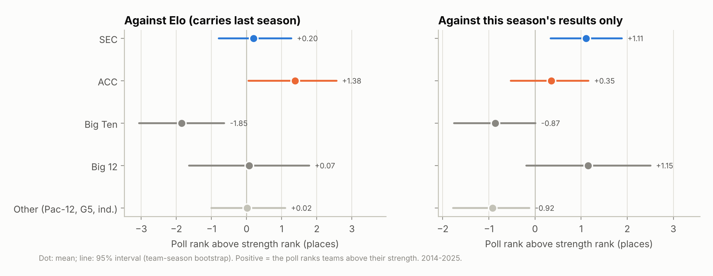

*Figure 11. H2: poll rank minus strength rank by conference, against Elo (left) and against the season-only rating (right), with 95% intervals.*

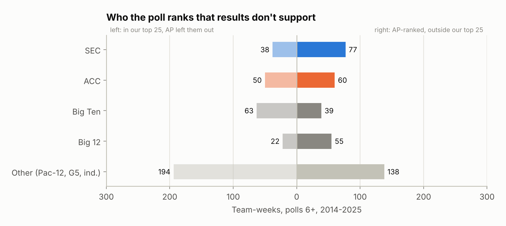

*Figure 12. H2: team-weeks ranked by the AP but outside the season-only top 25 (right), and the reverse (left).*

**H3 — Preseason carry-over (registered, as defined in deviation 9).** Holding record, margin, strength and week fixed, a team's points per voter in polls 6 and later rise by 0.48 for each point per voter it held in the preseason poll (CI 0.42–0.54; with Elo as the control, 0.52, CI 0.45–0.58). Extra carry-over for the SEC relative to the ACC is +0.04 (CI −0.16 to +0.24). Preseason standing is sticky, equally so for both conferences.

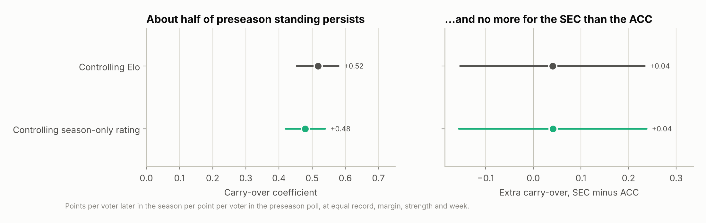

*Figure 13. H3: preseason carry-over at equal record, margin, strength and week (left), and the SEC-minus-ACC difference (right).*

**H4 — Rewards and punishments (added).** Residuals of the name-blind rated model for ranked teams, in points per voter (positive = rose more, or fell less, than results explain):

| Conference | After a win | After a loss | All weeks |
| --- | --- | --- | --- |
| SEC | +0.02 (−0.06, +0.09) | +0.03 (−0.16, +0.23) | +0.04 (−0.03, +0.12) |
| ACC | +0.09 (−0.04, +0.23) | −0.06 (−0.24, +0.14) | +0.06 (−0.03, +0.15) |
| Big Ten | −0.04 (−0.13, +0.07) | −0.19 (−0.47, +0.06) | −0.07 (−0.16, +0.02) |
| Big 12 | **+0.18 (+0.08, +0.30)** | −0.10 (−0.32, +0.16) | +0.08 (−0.03, +0.19) |
| Other | −0.06 (−0.17, +0.04) | −0.13 (−0.30, +0.05) | −0.07 (−0.15, +0.00) |
| **SEC − ACC** | −0.07 (−0.23, +0.09) | +0.09 (−0.20, +0.37) | −0.01 (−0.13, +0.11) |

Once opponent quality is measured by results rather than by poll standing, voters treat SEC and ACC results the same. The only clear conference effect is a reward for Big 12 wins.

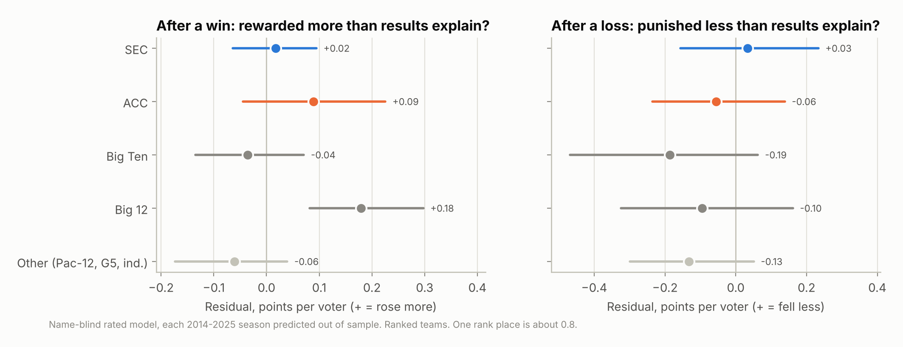

*Figure 14. H4: how far ranked teams beat the name-blind model after wins (left) and losses (right), by conference.*

**H5 — Schedule inflation (added), as originally computed.** Each team-season's schedule is ranked among FBS teams (1 = toughest) by opponents' poll points before each game and by opponents' final season-only rating:

| Conference | Mean rank by poll | Mean rank by results | Inflation (rating rank − poll rank) |
| --- | --- | --- | --- |
| **SEC** | 22 | 29 | **+6.7 (+3.9, +9.4)** |
| **ACC** | 52 | 45 | **−7.0 (−10.3, −3.7)** |
| Big Ten | 33 | 29 | −4.5 (−7.3, −1.7) |
| Big 12 | 41 | 40 | −1.6 (−6.4, +3.7) |
| Other | 84 | 88 | +4.2 (+2.5, +5.7)* |
| **SEC − ACC** | | | **+13.7 (+9.1, +17.9)** |

\*The Other figure is sensitive to ties at zero (teams that faced no ranked opponent); with average ranks it is +1.3. The SEC (+6.7) and ACC (−7.2) figures are not sensitive to this.

The first version of this report called this the clearest effect in the study. An outside review showed that it compares two measures that differ in two ways at once. **Shape:** the poll side scores every unranked opponent as zero, while the rating side gives every opponent credit. **Timing:** the poll side uses each opponent's standing on game day, the rating side its final rating. The timing gap is the effect under test; the shape gap is a measurement artifact. In 2026 through week 8 the original measure gives SEC +3.2 (−3.6, +10.1), ACC −10.5 (−21.8, −0.6), SEC − ACC +13.7 (+1.8, +27.2); it carries the same shape artifact.

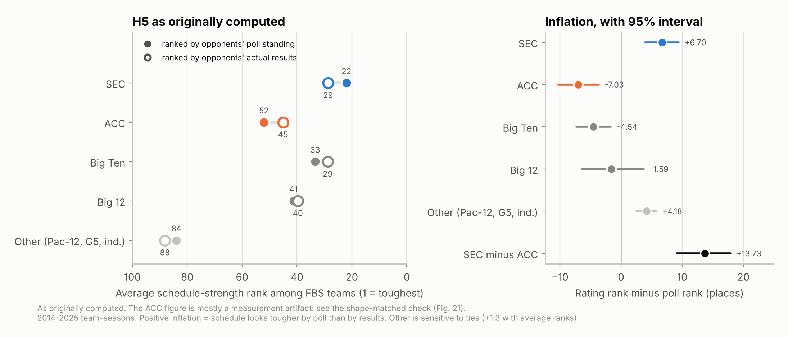

*Figure 15. H5 as originally computed: average schedule rank by opponents' poll standing (filled) and by their actual results (open), left; inflation with 95% intervals, right. The ACC figure is mostly a measurement artifact (Figure 21).*

**H5 sensitivity (added after an outside review; deviation 12).** The same comparison four ways (average ranks for ties; rank places; 95% intervals):

| Variant | Poll side | Rating side | SEC | ACC | SEC − ACC |
| --- | --- | --- | --- | --- | --- |
| A. As originally computed | Points per voter, game day | Final rating | +6.7 (+3.9, +9.4) | −7.2 (−10.6, −3.9) | +14.0 (+9.3, +18.2) |
| **B. Shape matched** | **Top-25 rank points, game day** | **Final top-25 rank points** | **+5.7 (+2.9, +8.9)** | **+2.1 (−1.1, +5.5)** | **+3.5 (−0.8, +8.0)** |
| C. Timing matched | Points per voter, final poll | Final rating | +1.9 (−1.5, +5.1) | −9.4 (−13.0, −6.0) | +11.4 (+6.6, +16.3) |
| D. Shape and timing matched | Top-25 rank points, final poll | Final top-25 rank points | +1.1 (−0.4, +2.4) | +0.5 (−1.1, +2.3) | +0.6 (−1.7, +2.7) |

Variant B is the fairest test of the claim: the same scale on both sides, game-day poll against final results. Under B:
- **The SEC effect survives.** SEC opponents are ranked about 5.7 places higher on game day than their final results justify, with an interval clear of zero. That is the preseason-rank mechanism the study set out to test.
- **The ACC effect disappears** (+2.1, interval includes zero). The original −7 came from ACC opponents that are often decent teams just outside the top 25: zero on the poll side, credit on the rating side.
- **The SEC-minus-ACC gap is not statistically clear** (+3.5, interval −0.8 to +8.0).

Variant D removes the game-day effect by design, so it is expected to show nothing; it is reported for completeness. The final regular-season poll is the poll after each season's last schedule week. The outside review used the poll one week earlier; with that choice C and D come out at SEC +1.2 and +0.2, ACC −9.7 and +0.1, and A and B are unchanged (`results/h5_sensitivity.json` holds both).

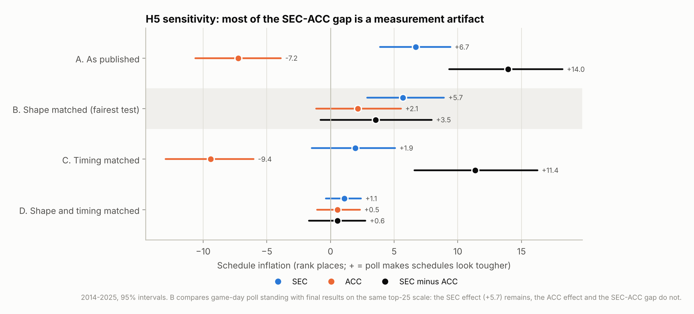

*Figure 21. H5 sensitivity: schedule inflation for the SEC, the ACC and SEC minus ACC under four ways of matching the two measures. B is the fairest test.*

**H6 — Elo's head start (added).** Relative to the season-only rating (polls 6+), Elo ranks SEC teams 0.91 places higher (−0.48, +2.18) and ACC teams 1.07 places lower (−2.55, +0.48). The SEC − ACC difference is **+1.98 (+0.03, +3.86)**. Elo carries roughly two positions more prior-season advantage for the SEC than for the ACC. That explains why the Elo-based version of H2 showed no SEC overrating: Elo shares part of the head start the test was looking for.

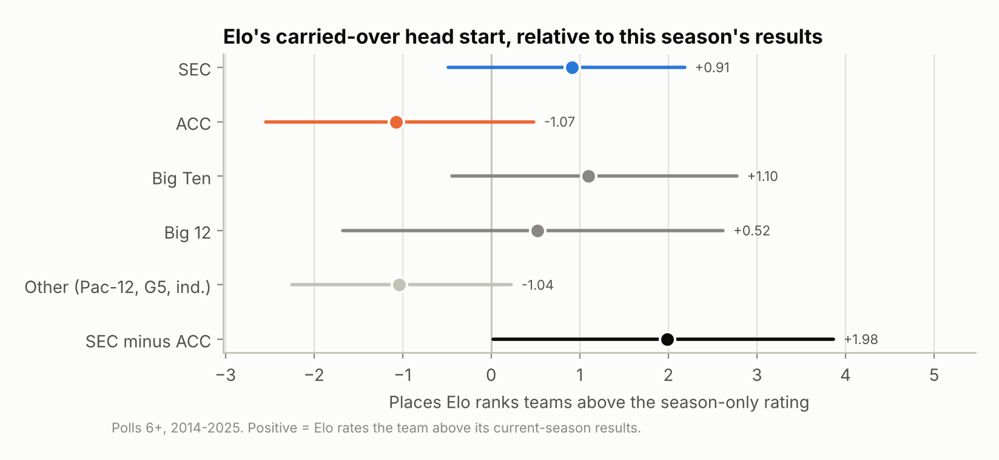

*Figure 16. H6: places Elo ranks teams above the season-only rating, by conference.*

### 5.5 What real voters do at poll 8 (2014–2025)

These counts use no model.

| Situation after seven weeks | Team-seasons | Ranked in poll 8 |
| --- | --- | --- |
| Power-4, 6-1 or better, started unranked | 30 | 100% |
| Power-4, 6-1 or better, started ranked | 65 | 100% |
| Power-4, 5-1 or better, started unranked | 73 | 75% |
| Power-4, 5-1 or better, started ranked | 107 | 100% |
| Started top 12, three or more losses | 18 | 6% |
| Started 13–25, three or more losses | 45 | 0% |

A strong record overrides preseason rank. At 5-1, teams that started ranked are always ranked, while a quarter of unranked starters are not. That gap is consistent with H3. It is not by itself evidence of bias, because teams that start ranked are usually stronger.

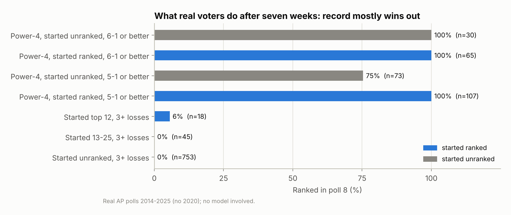

*Figure 17. Share of teams ranked in poll 8 by record and preseason status, real AP polls 2014–2025.*

### 5.6 The 2026 counterfactual

The 2026 preseason poll ranked nine SEC teams and three ACC teams (Miami #7, SMU #19, Louisville #24). Top-25 slots by conference at poll 9 (after week 8), unranked = 0:

| Run | Model | SEC | ACC | Big Ten | Big 12 | Other | Plausibility check |
| --- | --- | --- | --- | --- | --- | --- | --- |
| Real AP poll | — | 9 | 3 | 5 | 6 | 2 | Passes |
| No swap (sanity) | Rated | 11 | 2 | 7 | 4 | 1 | Fails |
| Three pairs swapped | Rated | 11 | 2 | 8 | 3 | 1 | Fails |
| Nine slots swapped | Rated | 6 | 6 | 8 | 4 | 1 | Fails |
| No swap (sanity) | Revised | 10 | 2 | 7 | 5 | 1 | Fails |
| Nine slots swapped | Revised | 4 | 8 | 7 | 5 | 1 | Fails |

- **Sanity run.** With the rated model and no swap, the simulated poll agrees with the real one reasonably well (ρ = 0.87; 20 of 25 teams shared).
- **Primary three-pair swap.** SMU (6-1) rises from a simulated #22 to #9 with Texas's preseason slot. Texas falls from #12 to #14. Miami (#2) and Georgia (#6) do not move.
- **Nine-slot extension.** Larger moves follow: Louisville and SMU +13, Virginia +9, Pittsburgh +8; Alabama −13, Ole Miss −8, Tennessee −6.
- **Plausibility** (the rule's base rates come from poll 8 in 2014–2025, §5.5). Every run fails, including the sanity run. The model leaves 6-1 Arizona (real #22) and 6-1 Wake Forest (real #14) unranked, and keeps Michigan, Oklahoma and Oregon (4-3) and Texas A&M (4-4) ranked (real: all unranked). The nine-slot swap adds further violations, ranking 4-3 Louisville and Washington, 4-4 Virginia, and 5-3 Pittsburgh and West Virginia. The real 2026 poll passes the same check.

These swap results reflect the model's attachment to starting position more than voter behavior, and are not used as evidence.

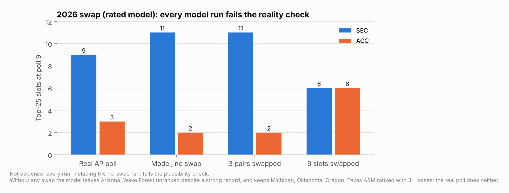

*Figure 18. 2026 top-25 slots by conference at poll 9: the real poll and the rated model's runs. Not evidence: every run, including the no-swap run, fails the plausibility check.*

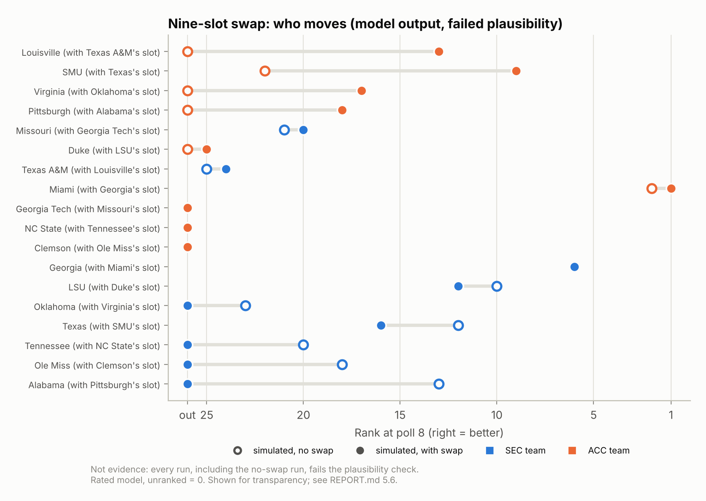

*Figure 19. Nine-slot swap, rated model: each paired team's simulated rank without and with the swap. Not evidence: every run, including the no-swap run, fails the plausibility check.*

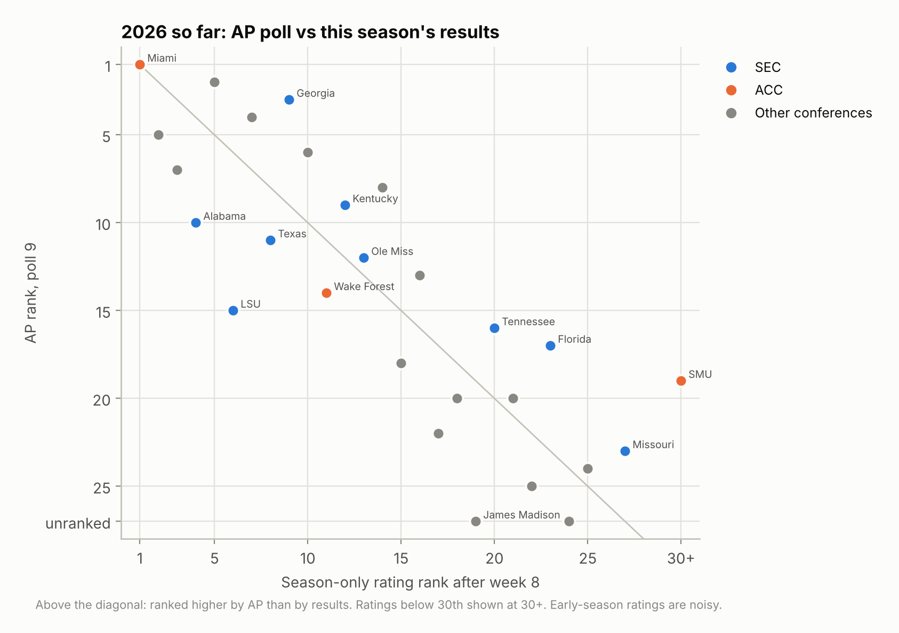

*Figure 20. 2026 to date: AP rank in poll 9 against the season-only rating after week 8.*

### 5.7 Exploratory team-level residuals

`src/team_bias.py` (not pre-registered) lists teams the model consistently over- or under-predicts. With the revised model on training seasons, conference averages for ranked teams are SEC +0.06, ACC +0.05, Big Ten −0.05 and Big 12 +0.07 points per voter. The only clear conference result is the Big 12 after wins (+0.19), consistent with H4. Team-level lists involve about 70 teams × 3 situations, so some flagged results are expected by chance.

### 5.8 Exploratory: who is over- and underrated in 2026 so far

Not a hypothesis test (logged in `DEVIATIONS.md` before it was run; recomputed through week 8 after the October 31 re-freeze). For teams in the AP top 25 of poll 9 or the season-only top 25 after week 8, two lenses:
- **Results lens:** season-only rank minus AP rank.
- **Voter lens:** how far voters have moved the team beyond what the name-blind model predicts from its results, summed over the season.

A team is labelled only when both lenses agree and the gap is at least 5 places. Full table: `results/rankings_2026.csv`.

| Verdict | Team (conference, record) | AP rank | Rank by 2026 results |
| --- | --- | --- | --- |
| Overrated | SMU (ACC, 6-1) | 19 | 30 |
| Overrated | Georgia (SEC, 6-1) | 3 | 9 |
| Overrated | BYU (Big 12, 6-1) | 8 | 14 |
| Overrated | Florida (SEC, 5-2) | 17 | 23 |
| Underrated | LSU (SEC, 6-2) | 15 | 6 |
| Underrated | James Madison (Sun Belt, 7-1) | unranked | 19 |

Two of the four clearly overrated teams are from the SEC, and one of the two underrated. Of the nine SEC teams on the board, eight have schedules that rank tougher by opponents' game-day AP rank than by opponents' 2026 results (for example Missouri 18.5th vs 57th and Florida 11.5th vs 26.5th; tied ranks are averaged). Georgia is the exception. This matches the H5 mechanism, but it is one season after eight weeks: ratings are noisy, see only scores, and are not a test. Strength of record for 2026 (§5.12) is a separate, résumé-style view of the same games.

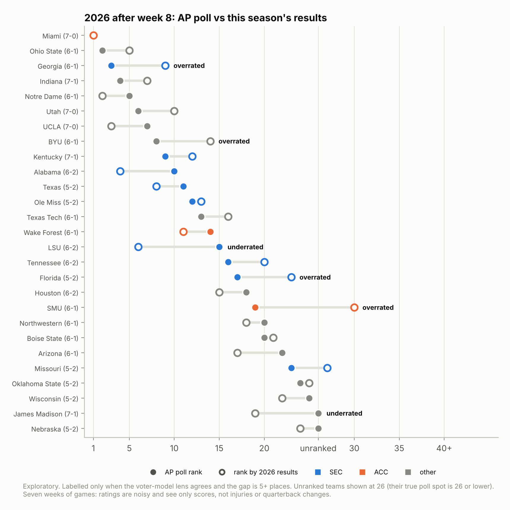

*Figure 22. 2026 after week 8: AP rank (filled) and rank by this season's results (open). Exploratory.*

### 5.9 Two tests of the preseason link (added last)

Added at Kyle's request after every earlier result had been seen, to test the two links the claim depends on. Definitions and how each result would be read were logged before either was run (`DEVIATIONS.md`, deviation 16).

**T1. Are SEC preseason rankings unjustified?** For each of the 275 teams ranked in a 2014–2025 preseason poll: where the season-only rating put it at season's end (capped at 26), minus its preseason rank. Every conference's preseason picks fall back on average (regression toward the middle), and higher-ranked teams have further to fall, so each team is compared with the all-conference expectation for its preseason rank.

| Conference | Preseason-ranked team-seasons | Finished below expectation (places) | Raw shortfall | Finished outside results top 25 |
| --- | --- | --- | --- | --- |
| **SEC** | 75 | **+0.09 (−1.63, +1.89)** | +4.6 | 36% |
| **ACC** | 39 | +1.60 (−0.71, +3.96) | +5.9 | 54% |
| Big Ten | 53 | −2.42 (−4.34, −0.32) | +2.3 | 28% |
| Big 12 | 41 | +1.78 (−0.78, +4.21) | +5.6 | 56% |
| Other | 67 | −0.21 (−2.01, +1.48) | +3.3 | 48% |
| **SEC − ACC** | | **−1.51 (−4.34, +1.45)** | | |

**Result: not supported.** SEC preseason-ranked teams finish almost exactly where their preseason rank predicts (+0.09 places). By the logged criteria this is not "supports" or "partial"; it is not formally "refutes" either, since the point estimate is just above zero, but it is indistinguishable from zero. If anything, ACC preseason picks hold up slightly worse: 54% finish outside the results top 25 against 36% for the SEC.

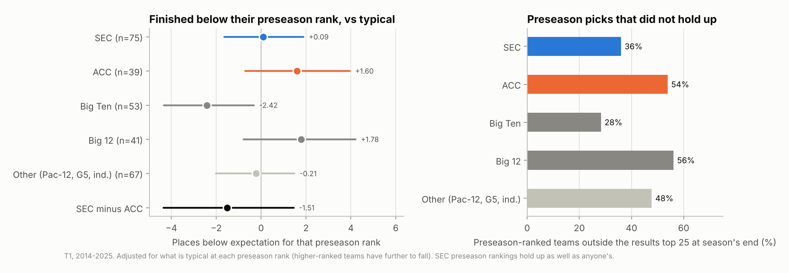

*Figure 23. T1: preseason rankings against season results, by conference, 2014–2025.*

**T2. Does the SEC's schedule boost come from early-season rankings?** For every regular-season game, the opponent's AP rank points in the poll before the game minus its final season-only rank points (the per-game form of H5 variant B; one point = one place inside the top 25), by part of the season:

| Conference | Weeks 1–4 | Weeks 5–8 | Weeks 9+ | Early minus late |
| --- | --- | --- | --- | --- |
| **SEC** | **+0.66 (+0.24, +1.13)** | **+1.16 (+0.70, +1.62)** | **+0.64 (+0.37, +0.93)** | +0.02 (−0.48, +0.53) |
| **ACC** | +0.10 (−0.20, +0.39) | +0.16 (−0.21, +0.52) | +0.06 (−0.19, +0.29) | +0.04 (−0.34, +0.43) |
| Big Ten | −0.24 (−0.64, +0.13) | −0.36 (−0.73, −0.01) | −0.45 (−0.68, −0.23) | +0.21 (−0.24, +0.63) |
| Big 12 | +0.24 (−0.10, +0.61) | +0.17 (−0.35, +0.70) | +0.51 (+0.17, +0.90) | −0.27 (−0.79, +0.24) |
| Other | −0.05 (−0.21, +0.10) | −0.23 (−0.35, −0.11) | −0.08 (−0.15, −0.00) | +0.02 (−0.14, +0.20) |
| **SEC − ACC** | **+0.56 (+0.06, +1.14)** | **+1.00 (+0.46, +1.59)** | **+0.59 (+0.22, +0.95)** | |

**Result: no preseason link shown, but a clear SEC-versus-ACC difference.** SEC opponents look better on game day than their seasons end up in every part of the season, not mainly early, so the boost is not tied to preseason rank specifically. In every band it exceeds the ACC's, with intervals clear of zero (secondary measure, logged in advance). Per game it is modest, about 0.6 to 1.2 places inside the top 25. This per-game measure finds a clear SEC-minus-ACC gap where the schedule-rank version (H5 variant B, +3.5 places, interval crossing zero) did not. Ranking whole schedules among about 130 teams is coarser, especially for the many teams that face few ranked opponents.

Two readings fit T2. Voters may keep SEC teams ranked above their results all season, which matches H2 (+1.1 places). Or the season-only rating may undervalue teams in a deep conference that beat up on each other, even with its opponent adjustment. These data cannot separate the two.

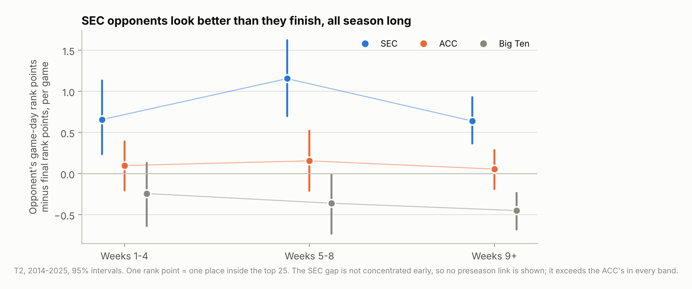

*Figure 24. T2: how much better opponents looked on game day than they finished, by part of the season, 2014–2025.*

### 5.10 Test of the in-season "ranked loop" (added last)

T2 left two explanations. This test checks the one about voters, a self-reinforcing loop: when two ranked teams from the same conference meet, the loser falls less than its season justifies (a "good loss"), and the winner collects credit for beating a ranked team. That would keep a conference with many ranked teams ranked above its results all season. Definitions and readings were logged first (`DEVIATIONS.md`, deviation 17). The measure is how far the poll ranked the team right after the game above where its season ended up by the season-only rating, beyond what is typical for its pre-game rank. All 1,359 qualifying team-games (each same-conference game appears once for each side) are in `results/t3_loop_games.csv`.

| Group | SEC | ACC | SEC − ACC |
| --- | --- | --- | --- |
| **Lost to a ranked conference rival** (primary) | **+0.44 (−0.67, +1.43)**, n = 152 | +0.96 (−0.77, +2.52), n = 38 | −0.52 (−2.55, +1.53) |
| Beat a ranked conference rival | +0.84 (−0.25, +2.16), n = 152 | +0.41 (−1.05, +2.02), n = 38 | +0.43 (−1.56, +2.49) |
| Lost to a ranked team from another conference (control) | +1.91 (−1.14, +4.68), n = 14 | +3.39 (+1.01, +5.64), n = 22 | −1.49 (−5.24, +2.27) |
| Lost to an unranked team (control) | +0.09 (−1.32, +1.37), n = 77 | +0.46 (−0.82, +1.53), n = 82 | −0.36 (−2.22, +1.46) |

**Result: not supported.** SEC teams that lose to a ranked SEC rival end up ranked about where their seasons finish. They drop a little further after such losses than ACC teams do (5.1 places against 4.4), and SEC winners gain no clear extra credit. What differs is volume: SEC teams played four times as many ranked-versus-ranked conference games as ACC teams (152 against 38). But each game is judged like anyone else's. The Big Ten is the outlier: after these games its teams sit about two places *below* where their seasons end.

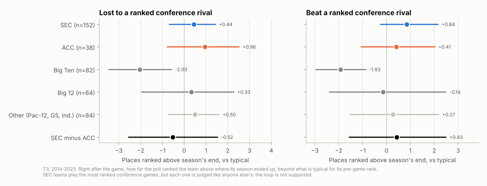

*Figure 25. T3: no in-season loop. SEC teams are judged after ranked conference games like everyone else.*

So the season-long SEC schedule boost in T2 is not explained by a voter loop in ranked conference games. Of the two explanations T2 left, the one that remains is that the season-only rating undervalues teams in a deep conference. In that case part of the boost is in our yardstick, not in the voters. The data here cannot confirm that either; it is what is left, not something shown.

### 5.11 Does the rating itself overrate the SEC? (added last)

Kyle objected that the finding "SEC schedules are tougher by results" may itself be biased. SEC teams mostly play each other, so the SEC's overall strength in any rating rests on its games against outsiders. This test referees the rating with those games: every FBS game between a conference's team and an outsider, from week 4 on plus all bowls and playoff games, which the rating never saw. It compares the actual margin (capped at ±28) with the margin the rating predicted before the game. Logged first (`DEVIATIONS.md`, deviation 18); every game is in `results/t4_referee_games.csv`.

| Conference vs outsiders | Games | Actual minus predicted margin (points) | Won (predicted) |
| --- | --- | --- | --- |
| **SEC, all** | 235 | **+3.35 (+1.68, +4.97)** | 177 (175) |
| SEC, bowls and playoff only | 34 | +1.74 (−2.46, +6.53) | 15 (19) |
| SEC, vs power-conference opponents | 86 | −0.22 (−3.07, +2.58) | 41 (45) |
| **ACC, all** | 257 | +0.13 (−1.70, +1.87) | 133 (142) |
| ACC, bowls and playoff only | 38 | −2.49 (−6.98, +1.87) | 16 (18) |
| ACC, vs power-conference opponents | 137 | **−3.10 (−5.39, −0.97)** | 48 (58) |
| Big Ten, all | 128 | +3.49 (+1.05, +5.97) | 95 (83) |

**Result: the objection is refuted.** Against outsiders, SEC teams do slightly better than the rating predicts, not worse. Against power-conference opponents they do almost exactly as predicted. So the rating does not overrate the SEC, and the finding that SEC schedules are tougher by results is not an artifact of how the rating calibrates conference strength. Against power-conference opponents it is the ACC that falls short of its rating, by about three points a game. In raw head-to-head games, with no model, the SEC went 58–46 against the ACC over 2014–2025, winning by 4.1 points on average; in bowls the two split, SEC 4 of 9.

### 5.12 Is the SEC ranked so high because of its results? (T5, added last)

Kyle rejected the conclusion that the SEC does not benefit from bias unless the data could show why the SEC is ranked so high, using evidence that does not depend on rankings. T5 answers that with **strength of record**, a résumé measure built only from that season's scores, venues and schedules: no polls, preseason, prior seasons, names or conference labels. For each team and week it asks how likely a typical top-25 team would be to win at least as many games against the same schedule. The benchmark is the mean performance rating of that week's 25 best teams; win chances use σ = 14.102 points, fixed from 6,520 FBS games. The design was reviewed by three independent reviewers and logged before any count was computed (`DEVIATIONS.md`, 2026-10-31, deviation 20). One disclosure matters: the margin-based performance version had been seen roughly during design, so it is descriptive only.

For every AP poll from poll 6 to the end of the regular season, 2014–2025, each group's AP top-25 slots are compared with its slots in the strength-of-record top 25 built from games through the week before (ties at 25th shared). The primary quantities are the SEC's excess E_SEC (AP slots minus strength-of-record slots, per poll), D_PWR (E_SEC minus the mean of the ACC, Big Ten, Big 12 and, through 2023, Pac-12) and D_ACC (E_SEC minus the ACC's). Intervals are t-intervals over the 11 seasons, with the count of positive seasons and an exact sign-flip test.

**Why the SEC is ranked so high.** With no rankings used at all, the SEC has the most teams in the strength-of-record top 25:

| Group | AP top 25, teams per poll | Strength-of-record top 25 | Strength-of-record top 10 |
| --- | --- | --- | --- |
| **SEC** | 6.17 | **5.49** | 2.87 |
| Big Ten | 4.63 | 4.74 | 2.47 |
| Big 12 | 3.59 | 3.42 | 1.43 |
| Pac-12 (to 2023) | 3.84 | 3.20 | 0.91 |
| **ACC** | 3.33 | **3.22** | 1.30 |
| Notre Dame | 0.83 | 0.76 | 0.31 |
| Group of 5 and others | 3.30 | 4.75 | 0.87 |

The SEC has 2.27 more strength-of-record top-25 teams per poll than the ACC (95% t +1.23 to +3.31; 10 of 11 seasons; sign-flip p 0.002).

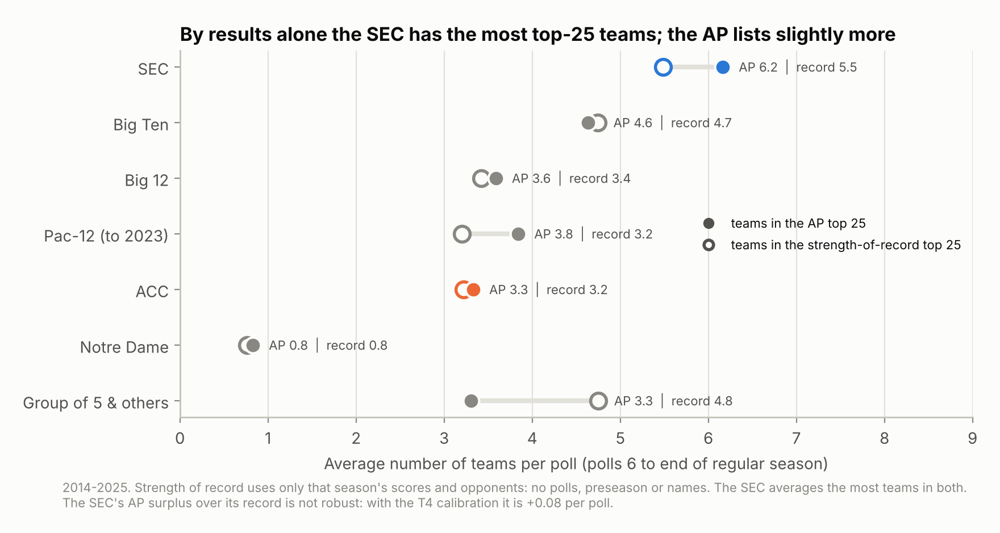

*Figure 26. Teams per poll in the AP top 25 (filled) and the strength-of-record top 25 (open), polls 6 to the end of the regular season, 2014–2025. By results alone the SEC has the most top-25 teams.*

**The AP lists a few more SEC teams than that.** Primary results:

| Quantity | Mean (slots per poll) | 95% t interval | Seasons positive | Sign-flip p |
| --- | --- | --- | --- | --- |
| E_SEC | +0.68 | +0.20 to +1.16 | 9 of 11 | 0.010 |
| D_PWR | +0.50 | −0.08 to +1.08 | 9 of 11 | 0.088 |
| D_ACC | +0.57 | +0.16 to +0.97 | 10 of 11 | 0.006 |

By group, the excess is SEC +0.68, Pac-12 +0.64, Big 12 +0.17, ACC +0.11, Notre Dame +0.07 and Big Ten −0.11, with Group of 5 and other teams −1.45. Under the logged reading, Part 1 is **over-ranked relative to strength of record, shared with the other power conferences, not SEC-specific**, and Part 2 is **SEC excess higher than the ACC's**. Taken as a bloc, the other power conferences pass the same over-ranking rule (+0.18, 95% t +0.03 to +0.32, 9 of 11 seasons; computed during the audit).

**Neither label is robust.** The logged gate requires E_SEC, D_PWR and D_ACC each to keep their sign in all 14 checks: 9 combinations of σ and benchmark, two calibrations of the rating against each conference's results with outsiders (T4 offsets), rank points, the Colley top 25 and the end-of-season record. E_SEC keeps its sign everywhere, but calibrated to all games against outsiders it falls from +0.68 to +0.08, D_PWR turns to −0.04 and D_ACC to −0.56. Calibrated to games against power-conference opponents, D_ACC is −0.20. So the season-long SEC surplus, and its size relative to the ACC, depend on how the rating is calibrated. The run commits read the gate on E_SEC alone; the audit (§5.14) corrected that.

**Descriptive results** (no claim language):
- **Against a margin-based ranking** the AP's SEC count is about the same: the excess over the performance top 25 is +0.07 (95% t −0.32 to +0.45). The T5 surplus is relative to won-lost record against schedule, not to margins.
- **By part of the season**, against the record to date: polls 6–8 +1.42, polls 9–11 +0.52, polls 12+ +0.31, final regular-season poll +0.45. Against the end-of-season record (the T6 yardstick, added after the audit): polls 6–8 @@B68@@, polls 9–11 @@B911@@, polls 12+ @@B12@@, final regular-season poll @@BEND@@.
- **Strength versus record.** A logged simulation (the "noise baseline") treats each season's final margin ratings as true strength and replays every game 200 times. A top 25 ordered by true strength holds about 1.46 more SEC teams per poll than a top 25 ordered by simulated record. The audit showed this barely depends on the simulated noise (SEC +1.58 with none), so it measures the built-in gap between ranking by strength and ranking by résumé, not noise. The real AP excess (+0.68) sits below that gap (observed minus baseline −0.78, 95% t −1.62 to +0.07): the AP's SEC count lies between a résumé ranking and a strength ranking.
- **2026 after week 8** (AP poll 9): Miami (7-0, AP #1) is #1 by strength of record, between #1 and #4 across the 11 settings, #2 by Colley and #2 by margin. Eight of the strength-of-record top 25 are SEC teams, against nine in the AP poll (E_SEC +1, fourth highest of the 12 seasons at the same poll). One season, no test.

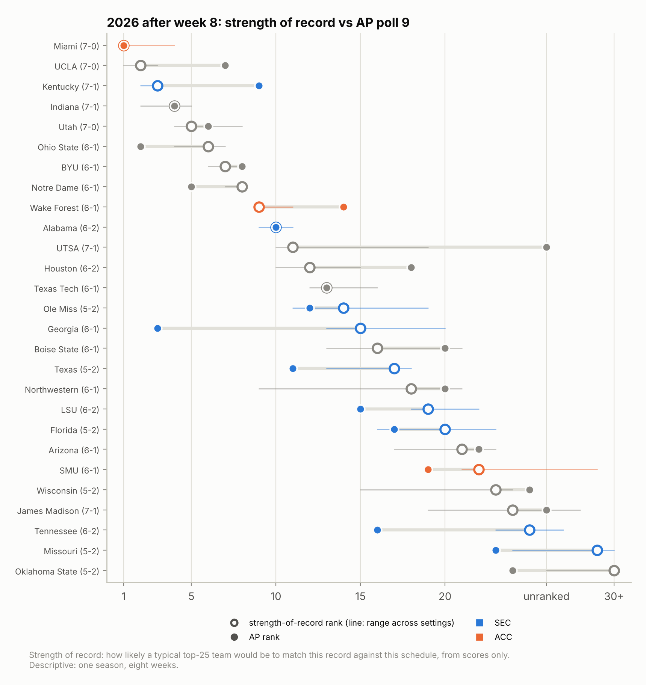

*Figure 27. 2026 after week 8: strength-of-record rank (open; line shows the range across 11 settings) against AP poll 9 rank (filled). Descriptive.*

### 5.13 Were SEC teams ranked higher early than their season justified? (T6, added last)

Kyle asked whether SEC teams were ranked higher in the early weeks than they should have been, or whether their preseason rankings hold up less often than other conferences', which would point to hype. T6 compares AP polls 1–5 (the preseason poll and the next four) with the **end-of-regular-season** top 25 by strength of record, using T5's groups, tie rules and statistics. It was logged before running and blind to T5's results (`DEVIATIONS.md`, 2026-10-31, deviation 21). The logged caveat applies to every result here: early polls reflect what voters knew then, so "not justified by how the season turned out" measures hype in hindsight and is not proof of intent.

| Quantity | Mean (slots per poll) | 95% t interval | Seasons positive | Sign-flip p |
| --- | --- | --- | --- | --- |
| E_SEC | **+1.65** | **+0.51 to +2.80** | 10 of 11 | 0.015 |
| D_PWR | +1.19 | −0.23 to +2.60 | 8 of 11 | 0.094 |
| D_ACC | +1.04 | −0.48 to +2.55 | 8 of 11 | 0.166 |

By group: SEC +1.65, Pac-12 +0.98, ACC +0.62, Big 12 +0.28, Notre Dame +0.13, Big Ten +0.08, Group of 5 and others −3.56. The preseason poll alone gives E_SEC +1.27 (95% t +0.07 to +2.48). Under the logged reading, Part 1 is **ranked higher early than the season justified, shared with the other power conferences, not SEC-specific**; Part 2 (SEC versus ACC) is **inconclusive**. E_SEC and D_PWR keep their sign in all 14 checks (E_SEC at least +0.93 per poll), but D_ACC turns to −0.15 under the all-games T4 calibration, so under the literal logged rule Part 1 is **not robust**. Taken as a bloc, the other power conferences pass the over-ranking rule (+0.47, 95% t +0.13 to +0.81, 10 of 11 seasons; computed during the audit).

**Ranked SEC teams fall out at the usual rate** (decomposition, added after the audit, descriptive). Each group's early excess splits into the drop out of the final top 25 expected for teams at those AP ranks, the drop beyond that, and unranked teams entering the final top 25. Across all teams, the share of early AP-ranked teams still in the final strength-of-record top 25 is 90% for ranks 1–5, 69% for 6–10, 58% for 11–15, 43% for 16–20 and 35% for 21–25.

| Group | AP top-25 teams per early poll | Expected to drop out | Drop beyond expected | Unranked teams entering |
| --- | --- | --- | --- | --- |
| **SEC** | 7.20 | 2.72 | **+0.07** | 1.13 |
| Big Ten | 4.81 | 1.74 | −0.55 | 1.11 |
| Pac-12 | 4.53 | 2.04 | +0.16 | 1.22 |
| Big 12 | 3.55 | 1.56 | +0.22 | 1.49 |
| **ACC** | 3.53 | 1.49 | +0.26 | 1.13 |

The SEC's drop beyond expected is +0.07 per poll (95% t −0.65 to +0.78; 4 of 11 seasons positive). Its early surplus comes from having the most early-ranked teams, which lose spots at the usual rate, not from each SEC team being more overrated than other teams at the same rank.

**T1 redone with strength of record.** Preseason-ranked SEC teams finish 0.27 ranks better than typical for their preseason rank (A_SEC −0.27, 95% t −2.15 to +1.61; 5 of 11 seasons; sign-flip p 0.74). The logged "hyped" reading is not met: there is no evidence that preseason-ranked SEC teams fell further short than typical. The interval is too wide to rule out a shortfall of up to about 1.6 ranks. The share finishing outside the final strength-of-record top 25 is 38.7% for the SEC (75 team-seasons), 53.8% for the ACC (39), 32.1% for the Big Ten, 56.1% for the Big 12 and 48.8% for the Pac-12.

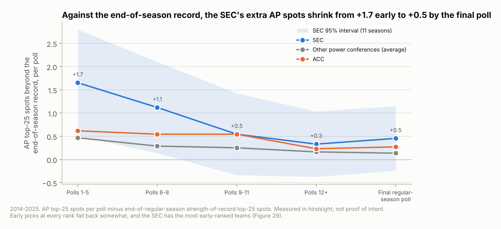

*Figure 28. AP top-25 spots per poll beyond the end-of-regular-season strength-of-record top 25, polls 1–5 (T6) and later stages (T5 bands on the same yardstick), 2014–2025. Shading: SEC 95% interval. Measured in hindsight.*

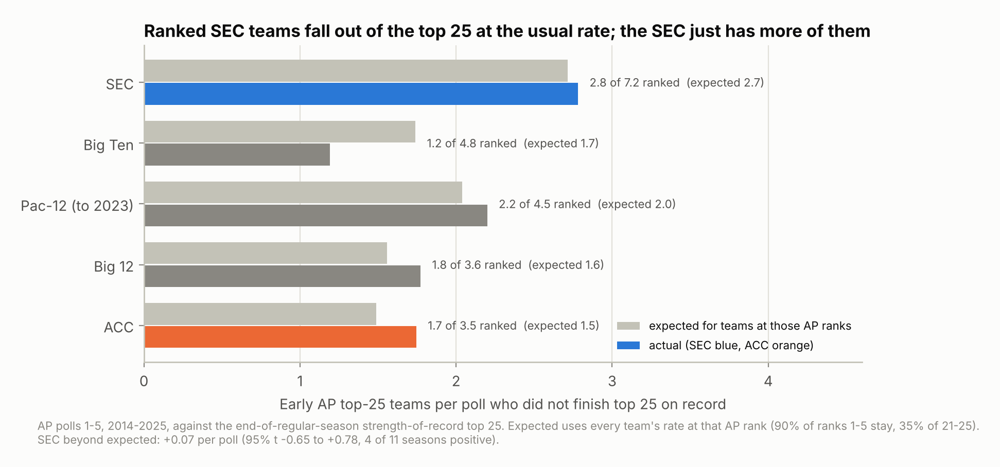

*Figure 29. AP polls 1–5, 2014–2025: early-ranked teams per poll who did not finish in the end-of-season strength-of-record top 25, expected at those AP ranks (gray) and actual. Ranked SEC teams fall out at the usual rate; the SEC has more of them.*

### 5.14 Audit of T5 and T6 (added last)

After T5 and T6 ran, an independent audit checked both scripts against their logged designs, looked for bugs and checked how the results were worded; each finding was then put to two skeptics asked to refute it. No bug changed a logged number. The corrections, logged before the reruns that use them (`DEVIATIONS.md`, 2026-10-31, deviation 22):

1. **Robustness verdict per label.** The code reported a sign check for each quantity but never applied the logged rule to the labels. Under that rule both T5 labels and T6 Part 1 are not robust (§5.12, §5.13). The scripts now write the verdict and list where each sign flips.
2. **Gate summary units.** Its range and ±0.5 band check mixed rank points with slots; they now use slots only.
3. **Logged outputs left out.** T6 now writes the logged "hyped" reading (not shown) and the hindsight caveat.
4. **Two descriptive additions, post hoc:** the T5 bands against the end-of-season record, and the T6 decomposition.
5. **The "noise baseline"** is described as the gap between ranking by strength and by record, which is what it measures.
6. **Wording:** "over-ranked" is stated as relative to strength of record; the preseason shortfall is reported as "no evidence of", not "no shortfall"; figure captions were corrected.

Refuted by the skeptics, and not acted on: the claim that "shared with the other power conferences" is contradicted by the data. As a bloc the other power conferences pass the same over-ranking rule in both tests (figures above).

---

## 6. Deviations from the pre-registered plan

Every entry is dated in `DEVIATIONS.md` and was committed before use. The last column states what had been seen when each decision was made.

| # | Change | Reason | Decided after seeing |
| --- | --- | --- | --- |
| 1 | Unranked = 0 kept as primary; floor rule added as sensitivity | API lists only the top 25 | Data only |
| 2 | Week-0 games combined, postseason excluded, FCS games counted | Source labelling | Data only |
| 3 | Games after the poll they would feed dropped | Leakage test found 2019 Army–Navy | A failing test |
| 4 | Replay mechanics and pass-test details fixed | Methodology left them open | Nothing beyond training data |
| 5 | Points per voter; season-to-date record as inputs | Replay was too sticky; panel grew | Training-season results |
| 6 | Stickiness yardstick set from the holdout (larger value) | Holdout stickiness exceeded training | Holdout results |
| 7 | Swap pairing (three pairs primary, nine-slot extension) | Nine SEC vs three ACC teams ranked in 2026 | 2026 preseason poll only |
| 8 | Post-hoc plausibility check (base rates) | Swap produced implausible rankings | Counterfactual results |
| 9 | Hypothesis test definitions, including H3 | Methodology left details open | Base rates |
| 10 | Season-only rating replaces Elo as the primary yardstick; Elo kept for comparison | Elo carries 67% of the prior season | Elo-based hypothesis results |
| 11 | Rated model; H4–H6; swap re-run with a pre-set plausibility check | Opponent strength measured by poll standing alone carries the effect under test | Season-rating results |
| 12 | H5 sensitivity: shape and timing matched | Outside review found H5 mixed a real effect with a measurement artifact | All results, including the published report |
| 13 | Raw data no longer committed; fetched and checksum-verified | CollegeFootballData.com terms do not allow publishing stored raw API responses | All results (no number changes) |
| 14 | Model training forced to one thread | Results differed across machines with different thread counts | All results; only rated-model floor-rule figures move, none cited here |
| 15 | Exploratory 2026 over/underrated board (§5.8) | Kyle's request for a current-season view | All results |
| 16 | T1 and T2: tests of the preseason link (§5.9) | Close the two gaps between the claim and the evidence | All results, including §5.8 |
| 17 | T3: in-season ranked loop (§5.10) | Test the explanation proposed for T2 | All results, including T1 and T2 |
| 18 | T4: does the rating overrate the SEC? (§5.11) | Kyle's objection that the results yardstick is biased | All results, including T3 |
| 19 | 2026 re-frozen through week 8 (AP poll 9); historical files unchanged (2026-10-31) | The methodology's 2026 analyses cover all completed weeks | All results through week 7 |
| 20 | T5: ranking-independent strength of record against the AP top 25 (§5.12; 2026-10-31) | Kyle asked for results-only evidence of why the SEC is ranked so high | All results, including H2 and T1–T4; the performance-top-25 version was seen during design and is descriptive only |
| 21 | T6: early polls against the end-of-season record (§5.13; 2026-10-31) | Kyle asked whether SEC teams were ranked higher early than they should have been | All earlier results; logged blind to T5's results |
| 22 | Corrections after an audit of T5 and T6 (§5.14; 2026-10-31) | Label-level robustness verdict missing, gate units mixed, logged outputs left out, wording | T5 and T6 results; no logged number changes; two descriptive outputs added post hoc |

Deviations 5, 6, 8, 10, 11, 12 and 15–22 were made after some results were known. None changed how the holdout was scored. Results under the original specifications are reported alongside wherever they exist, and the original Elo-based results remain in `results/hypothesis.json`.

---

## 7. Discussion

### 7.1 Against the pre-registered criteria

| Criterion | Result | Verdict |
| --- | --- | --- |
| Swap lifts ACC teams substantially | ACC teams rise in every swap run, but every run, including the no-swap run, fails the plausibility check | Not established |
| SEC poll standing above independent strength | Above the season-only rating (+1.1, CI excludes zero); above strength of record by 0.68 teams per poll (T5), but not robust to calibrating the rating against outsiders (+0.08); not above Elo, which shares the head start (H6) | Supported, with caveats |
| SEC poll standing matches strength (refutation) | Matches Elo; does not match current-season results | Not met |

By the letter of the pre-registration, the claim is neither confirmed (the swap evidence is unusable) nor refuted (the SEC is ranked above its current-season strength). The registered tests on their own point slightly against it. H1 favors the SEC only in a model that fits worse than predicting no change, and H2 against Elo shows the poll rating ACC teams above Elo and SEC teams in line with it. The season-only yardstick that shows SEC overrating replaced Elo after those results were seen (deviation 10), because preseason Elo is 0.67 × last season's final Elo and so carries the head start being tested.

### 7.2 What the evidence shows

The study distinguishes five ways the SEC could benefit, or appear to:

1. **Voters score SEC games more generously.** Not supported. For the same result against the same quality of opponent, SEC and ACC teams move alike (H4). The H1 result pointing the other way comes from a model that fits worse than predicting no change.
2. **Preseason standing persists, and the SEC starts with more of it.** Supported, but the effect is general. About half of preseason standing persists into mid-season at equal performance, for every conference alike (H3). The SEC benefits because it begins with more ranked teams, not because its rankings are stickier.
3. **The poll inflates the perceived strength of SEC schedules.** Supported for the SEC, not as an SEC-versus-ACC difference. On a matched scale, SEC opponents are ranked about 5.7 places higher on game day than their final results justify (H5 sensitivity, variant B). That is the mechanism in the original claim. The ACC shows no comparable effect, but the SEC-minus-ACC gap (+3.5 places) is not statistically clear. The original H5 figures (+6.7 SEC, −7.0 ACC, gap 13.7) overstated the contrast through a measurement artifact. Measured per game (T2), the SEC-minus-ACC difference is clear in every part of the season. It does not fade as preseason rankings wash out, and SEC preseason rankings themselves hold up as well as anyone's (T1). So the mechanism is not "unjustified preseason rankings". Nor is it an in-season loop in which ranked SEC teams soften each other's losses (T3): SEC teams are judged after ranked conference games like anyone else. What remains is that SEC opponents stay ranked above our rating's view of them all season. That may be voters, or a rating that undervalues teams in a deep conference. T4 lends the second reading some support: against all outsiders SEC teams beat the rating's predictions by 3.35 points a game, although against power-conference opponents the rating is accurate.
4. **The SEC's strength is itself a product of rankings.** Not supported. A strength-of-record top 25 built only from scores and schedules, with no rankings, holds more SEC teams than any other conference's: 5.5 per poll, against 4.7 for the Big Ten and 3.2 for the ACC (T5). SEC teams also beat the rating's predictions against outsiders (T4), and the SEC went 58–46 head-to-head against the ACC. The AP lists 0.68 more SEC teams per poll than strength of record does, shared with the other power conferences, but that surplus is not robust: calibrated to results against outsiders it is +0.08, and against a margin-based ranking the AP's SEC count is about even (+0.07).
5. **Early polls over-count SEC teams.** Supported as a count, not as SEC-specific overrating. In polls 1–5 the AP holds 1.65 more SEC teams per poll than finish in the end-of-season strength-of-record top 25, the most of any conference (T6). But at the rates seen for every team at those AP ranks, ranked SEC teams fall out of the final top 25 as expected (+0.07 beyond expected): the surplus comes from the SEC having the most early-ranked teams, and every early ranking regresses. Measured against the same end-of-season yardstick, the SEC's extra spots shrink to @@BEND@@ by the final regular-season poll. This is the part of Kyle's mechanism the data do show: "ranked" opponents early in the season are often not top-25 teams by season's end, and SEC teams play the most of them.

The net result is that SEC teams sit about one position above what their current-season results support (H2). The SEC-minus-ACC difference (+0.76) is not distinguishable from zero. The Big 12 shows a similar overrating, and Group of 5 teams are underrated by about the same amount, so this is not unique to the SEC. Part of it may sit in the yardstick rather than the voters (T4, T5).

On Miami in 2026, the one season examined directly: after week 8 Miami (7-0) is #1 by strength of record and between #1 and #4 across 11 settings (§5.12). None of its opponents was in the AP top 25 on game day, so by game-day poll rank its schedule ranks 94th of 138; by opponents' 2026 results it ranks 56th. "Played nobody" overstates it. This is descriptive and rests on eight weeks of games.

### 7.3 On the ACC

The ACC's own teams are not ranked below their current-season strength (H2: +0.35, not distinguishable from zero), and voters do not punish ACC results more (H4). The first version of this report also said ACC schedules are undersold. That does not survive the shape-matched check: ACC schedule inflation is +2.1 (CI −1.1 to +5.5). The apparent undercount came from ACC opponents just outside the top 25, which the poll side scored as zero. Per game, ACC opponents' game-day rankings match how their seasons end (T2: about +0.1 places in every part of the season), so ACC schedules are rated fairly rather than undersold. The gap with the SEC comes from SEC schedules getting extra credit. Whether ACC teams with SEC-like preseason positions would be ranked as highly could not be answered reliably (§5.6).

### 7.4 On Elo

Elo is independent of voters but not of the previous season. Its season-to-season carry-over (0.67) gives the SEC about two positions more head start than the ACC relative to current-season results (H6). Comparisons against Elo therefore understate any advantage the SEC carries from prior reputation. That is why the Elo-based test (H2, first column) found no SEC overrating while the current-season test did.

---

## 8. Limitations

1. **Voter behavior, not team quality.** The models describe how voters react to results. The season-only rating is a measure of performance, not a definitive measure of quality.
2. **The season-only rating uses scores only.** It ignores injuries, quarterback changes and other information voters may legitimately use, and some apparent "overrating" may reflect that information. Its blend weight and margin cap were fixed in advance but are choices. It is noisy before week five, so H2–H4 that use it are restricted to polls 6 and later.
3. **Missing votes below #25.** All points-based quantities treat teams outside the top 25 as unranked. Results are reported under two rules and are similar.
4. **The counterfactual is not credible.** Even the best model is stickier than real voters, and every swap run fails a plausibility check that the real poll passes. The counterfactual also assumes games would end with the same scores regardless of rankings.
5. **The holdout was used once for the registered and revised models.** The rated model was defined afterwards, and its 2024–2025 numbers are labelled as a re-used holdout.
6. **Several analyses were added after earlier results were seen** (§6), including T1–T6, which carry most of the conclusions. Each was logged before it was run, and its timing is disclosed; T6 was logged blind to T5's results, and two T5/T6 outputs were added after an audit as descriptive only. Readers should weigh these as less confirmatory than the pre-registered tests.
7. **Multiple comparisons.** Five conference groups, several situations and two unranked rules produce many intervals; a few are expected to exclude zero by chance. H3 and the SEC schedule effect under the matched H5 check have intervals clear of zero. Of the SEC-versus-ACC contrasts, only H1 (in a model that fits poorly) and H6 (Elo's head start) exclude zero, both barely; none of those that measure how voters treat the two conferences does.
8. **Observational design.** Preseason rank is not randomly assigned. Controls for record, margin and strength reduce but cannot remove confounding.
9. **Single source per data type.** Results depend on the accuracy of the CFBD poll data and the cfbfastR-data schedules.
10. **Measurement choices matter.** The original H5 result changed substantially once the two schedule measures were put on the same scale. Other comparisons between a top-25 poll and a continuous rating (H2, H6) use ranks capped at 26 on both sides, which limits but may not remove the same problem.
11. **One résumé yardstick.** Strength of record is one model of a résumé. It was checked across 9 combinations of σ and benchmark, two calibrations, rank points and a wins-and-losses ranking, and the checks that fail are reported. A strength ranking and a résumé ranking differ by design: in simulation, a top 25 ordered by true strength holds about 1.46 more SEC teams per poll than one ordered by record (§5.12).
12. **Hindsight.** T6 compares early polls with how the season turned out. Voters ranked teams with what they knew then; "not justified by the season" is not proof of intent.
13. **Calibration sensitivity.** The season-long T5 surplus (+0.68 SEC teams per poll) and the SEC-versus-ACC contrasts in T5 and T6 change sign or vanish under one of the two pre-set calibrations of the rating against outsiders. The early-poll SEC surplus (T6) and the SEC's lead in strength-of-record top-25 teams do not.
14. **2026 is descriptive.** Eight weeks of games, one season, no test.

---

## 9. Conclusion

Kyle's two claims fare differently, and both parts are stated with equal weight.

**What the data support.** Miami's 2026 record is strong by results alone: after week 8 it is #1 by strength of record, and its schedule, though it has faced no team ranked on game day, is mid-pack by opponents' results (56th of 138), not "nobody". Rankings do flatter SEC schedules. SEC opponents are ranked about 5.7 schedule places higher on game day than their final results support, and 0.6 to 1.2 places per game, more than ACC opponents. Early polls list more SEC teams than finish in the top 25 on results: 1.65 per poll in polls 1–5, the most of any conference. SEC teams sit about one poll position above their current-season results.

**What the data do not support.** The SEC's strength is not a ranking artifact. With no rankings used at all, the SEC has the most teams in the strength-of-record top 25 (5.5 per poll, against 4.7 for the Big Ten and 3.2 for the ACC), and its teams beat the rating's predictions against outsiders. Ranked SEC teams fall out of the top 25 at the usual rate for their rank; the early surplus comes from the SEC having more of them. SEC preseason picks hold up as well as anyone's, voters do not grade SEC results more generously, and there is no ranked "swap seats" loop in conference games. The one-place poll benefit is shared with the Big 12, and the season-long surplus over strength of record is not robust to calibrating the rating against outsiders.

So "ranked wins" and game-day schedule ranks oversell SEC schedules, most of all early in the season, and results-based measures should be preferred. But by results alone the SEC is the strongest conference, and its high rankings are mostly earned. The first version of this report claimed ACC schedules are undersold; that was a measurement artifact and is withdrawn. Whether ACC teams would rise to SEC-like rankings given SEC-like starting positions cannot be determined with these models, and we do not claim it.

---

## 10. Reproducibility

```bash
pip install -r requirements.txt
export CFBD_API_KEY=...    # free key: https://collegefootballdata.com/key
python run_all.py
```

`run_all.py` first runs `src/fetch_data.py`, which downloads the 39 raw files (they are not committed; §3.1) and fails unless every one matches its checksum in `data/MANIFEST.json`. It then rebuilds every number and figure in this report offline. `src/score_holdout.py` fails if the recomputed holdout differs from the recorded `results/holdout.json`. `src/pull_data.py` re-pulls and re-freezes the data; running it would change the frozen inputs and must be logged.

**What independent rebuilds showed.** An outside review rebuilt the first version on a different machine. Every headline number reproduced, and most files matched to floating-point precision. One sensitivity run, the rated model under the floor rule, varied slightly, because gradient-boosted training sums in parallel and the order depends on the machine's thread count. Training is now forced to one thread (deviation 14). An independent rebuild from a fresh clone of commit `a423161`, deliberately run with four threads requested, then downloaded and verified all 39 raw files, passed all 12 tests and reproduced all 51 committed result files byte for byte.

### File map

| Result | File | Script |
| --- | --- | --- |
| Data checksums; raw data download | `data/MANIFEST.json` | `src/pull_data.py` (original pull), `src/fetch_data.py` (rebuild), `src/verify_data.py` |
| Training metrics, model specs | `results/train_metrics.json`, `results/model_spec.json` | `src/train.py` |
| Training-season replay | `results/replay_training.json` | `src/replay.py` |
| Holdout (once) | `results/holdout.json` | `src/score_holdout.py` |
| Rated model, holdout re-used | `results/holdout_reuse_rated.json` | `src/evaluate_rated.py` |
| Season-only rating validation | `results/season_rating_validation.json` | `src/season_rating.py` |
| H1–H3 | `results/hypothesis.json` | `src/hypothesis.py` |
| H4–H6 | `results/bias_tests.json`, `results/schedule_strength_2026.csv` | `src/bias_tests.py` |
| H5 sensitivity | `results/h5_sensitivity.json` | `src/h5_sensitivity.py` |
| Real-voter base rates | `results/base_rates_poll8.json` | `src/base_rates.py` |
| Counterfactual | `results/counterfactual_2026.json`, `results/counterfactual_2026_rated.json` | `src/counterfactual.py` |
| Exploratory team residuals | `results/team_bias_*.csv`, `results/conference_bias_*.csv` | `src/team_bias.py` |
| 2026 over/underrated (exploratory) | `results/rankings_2026.csv` | `src/rankings_2026.py` |
| T1 and T2 (preseason link) | `results/preseason_tests.json` | `src/preseason_tests.py` |
| T3 (ranked loop), every qualifying game | `results/t3_loop.json`, `results/t3_loop_games.csv` | `src/loop_test.py` |
| T4 (rating referee), every game | `results/t4_referee.json`, `results/t4_referee_games.csv` | `src/referee_test.py` |
| T5 (strength of record vs the AP top 25); every team-week's strength of record, Colley and performance ranks (no poll data); 2026 table | `results/t5_sor.json`, `results/sor_weekly.csv`, `results/sor_2026.csv` | `src/sor_test.py` |
| T6 (early polls vs the end-of-season record), with decomposition | `results/t6_early.json` | `src/early_test.py` |
| Every number in the summary and the LinkedIn post, with its source | `results/post_numbers.json`, `SUMMARY.md` | `src/post_numbers.py` |
| Figures 1–29 | `results/figures/*.png` | `src/figures.py` |
