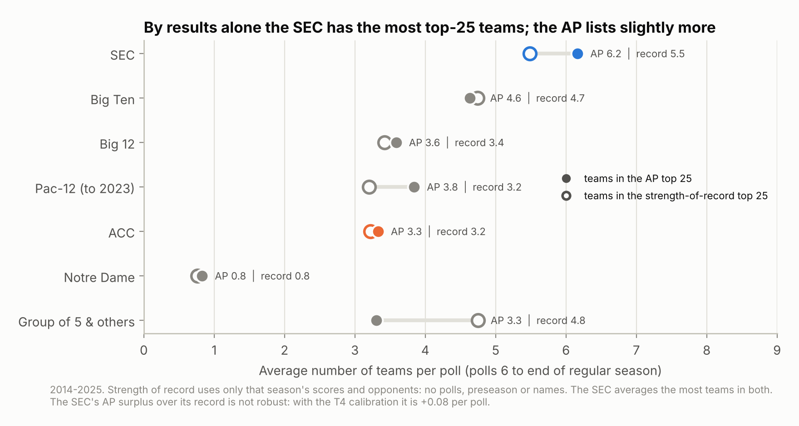
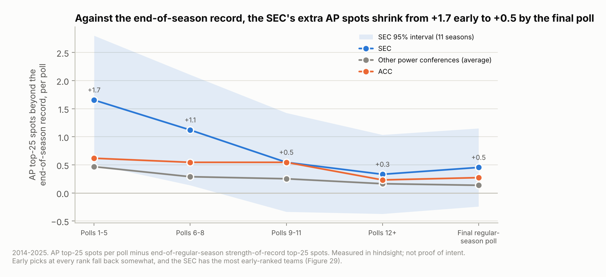

# Is the SEC overrated, or just good?

**One-page summary of this study.** Every number below comes from a result file in [`results/`](results/), and most are collected with their source keys in [`results/post_numbers.json`](results/post_numbers.json). Everything rebuilds with `python run_all.py`. The full write-up is [`REPORT.md`](REPORT.md).

## The question

Kyle Bowlsbey, a Miami fan, went in believing two things:

1. **"Miami has played nobody" is false.** Judged only on this season, Miami's record is strong.
2. **SEC schedules look hard because SEC teams start the season ranked.** So many SEC teams are ranked that they "swap seats": a loss is a good loss to a ranked team, a win is a tough win over one, and the cycle keeps going. Put Big Ten or ACC teams in their place and they would look just as strong.

## How it was tested

- **Seasons:** AP polls for 2014–2025, leaving out 2020 (11 seasons), plus a descriptive look at 2026 through week 8.
- **Yardsticks:** built only from that season's scores and schedules. They use no polls, no preseason information and no team names.
  - **Strength of record** (the main one): how likely a typical top-25 team would be to post this record or better against this schedule. It grades résumés, not raw strength.
  - **A season-only rating** (schedule-adjusted scoring margins and wins and losses) for the schedule and poll-place comparisons.
- **Procedure:**
  - The plan was committed before any data was pulled ([`METHODOLOGY.md`](METHODOLOGY.md)).
  - Every later change was logged with what had been seen at the time ([`DEVIATIONS.md`](DEVIATIONS.md)).
  - The last two tests (T5 and T6) got an independent audit of their code and wording, with skeptics asked to refute each finding.
  - Every claim in this summary was then checked against the result files by reviewers told to knock it down.
- **Caveat:** every test in this summary was added mid-study, after earlier results had been seen. Most were logged before they ran. The exceptions are marked below.

## Hypothesis 1: Miami "played nobody". **Not supported by results.**

After week 8 of 2026 ([`results/sor_2026.csv`](results/sor_2026.csv), [`fig28`](results/figures/fig28_2026_sor.png)):

- **Ranking:**
  - Miami is 7–0 and **#1 by strength of record**, and between #1 and #4 across all 11 settings tested.
  - UCLA, also 7–0, is a close #2 and is #1 by wins and losses alone (Colley).
  - Miami is #2 by wins and losses and #2 by scoring margin.
- **What is true:** none of Miami's opponents was in the AP top 25 on game day. Counted that way, its schedule is tied for last with 44 other teams that have not faced a ranked opponent yet.
- **What is not:** counted by how those opponents have actually played in 2026, the schedule ranks **56th of 138**. That is the middle of the pack, not "nobody". It is softer than most contenders' schedules: 48th of 67 among power-conference teams.
- **Best win:** Miami won 33–20 at Wake Forest in week 3. Wake Forest was unranked then. It is now 6–1, AP #14 and #9 by strength of record, and its only loss is to Miami.

One season and eight weeks of games: this part is descriptive, not a test.

## Hypothesis 2: rankings make SEC schedules look hard. **Partly supported.**

**What holds up (supports Kyle):**

- **Early polls list more SEC teams than finish top 25 on results.** In AP polls 1–5, the AP top 25 holds **1.65 more SEC teams per poll** than the end-of-regular-season strength-of-record top 25 (95% CI +0.51 to +2.80; 10 of 11 seasons; [`results/t6_early.json`](results/t6_early.json), [`fig27`](results/figures/fig27_excess_by_stage.png)).
  - It is the most of any conference, and it stays positive in all 14 robustness checks (at least +0.93; +1.2 against a margin-based top 25).
  - It is not SEC-only. The other power conferences are also listed early above their results: Pac-12 +0.98, ACC +0.62, Big 12 +0.28, Big Ten +0.08; together +0.47 (CI +0.13 to +0.81).
  - The SEC's lead over them (+1.19, CI −0.23 to +2.60) and over the ACC (+1.04, CI −0.48 to +2.55) is not statistically clear. The pre-set reading is therefore "shared with the other power conferences, not SEC-specific". Under the literal robustness rule it is not robust, because the SEC-minus-ACC gap turns slightly negative (−0.15) under one calibration.
  - The yardstick is hindsight. Early polls reflect what voters knew then.
- **Game-day rankings flatter SEC schedules all season, not just early.**
  - **Whole schedules:** ranked by opponents' AP rank on game day, SEC schedules look about **5.7 places tougher** (of ~130) than they do ranked by those opponents' final results (95% CI +2.9 to +8.9; [`results/h5_sensitivity.json`](results/h5_sensitivity.json)).
  - **Other conferences:** they get smaller boosts that are not statistically clear: Big 12 +3.3 (CI −0.8 to +7.8), ACC +2.2 (CI −1.1 to +5.5). SEC minus ACC is +3.5 (CI −0.8 to +8.0), also not clear.
  - **Final poll:** measured with the final poll instead of the game-day poll, the SEC gap is +1.1 (CI −0.4 to +2.4).
  - **Provenance:** an outside reviewer ran this check before it was logged.
  - **Game by game:** SEC opponents look **0.66** rank points better on game day than their seasons end up in weeks 1–4, **1.16** in weeks 5–8 and **0.64** from week 9 on. Early minus late is +0.02 (CI −0.48 to +0.53), so this is not a preseason effect that wears off. ACC opponents look about 0.1 better ([`results/preseason_tests.json`](results/preseason_tests.json)).
- **The SEC has the most early-ranked teams that later fade.** In polls 1–5 the SEC holds 7.2 top-25 spots per poll, and 2.8 of them miss the final top 25 by record. That volume is what gives SEC teams so many "ranked" opponents.
- **The power conferences' extra AP spots come mostly at the expense of Group of 5 teams.** From poll 6 on, the AP lists 3.3 Group of 5 and other teams per poll; strength of record has 4.8 (descriptive; [`fig26`](results/figures/fig26_sor_levels.png)).
- **SEC teams sit about one poll place above the season-only rating** (+1.1 places, 95% CI +0.3 to +1.9; [`results/hypothesis.json`](results/hypothesis.json)).
  - The Big 12 is similar (+1.2), and SEC minus ACC is not clear (+0.76, CI −0.43 to +1.93).
  - This was not rerun with the calibration that erases the season-long surplus below.

**What does not hold up:**

- **The SEC's strength is not a ranking artifact.** With no rankings used at all, from poll 6 on, the SEC has the most teams in the strength-of-record top 25 ([`results/t5_sor.json`](results/t5_sor.json), [`fig26`](results/figures/fig26_sor_levels.png)).
  - **Per poll:** SEC 5.5, Big Ten 4.7, Big 12 3.4, ACC 3.2, Pac-12 3.2.
  - **Lead over the others:** clear over the ACC (+2.27, CI +1.23 to +3.31), the Big 12 (+2.06) and the Pac-12 (+1.87).
  - **Lead over the Big Ten:** not clear (+0.74, CI −0.55 to +2.03). The SEC had more in only 6 of 11 seasons.
  - **2026 to date:** 8 of the strength-of-record top 25 are SEC teams.
- **The results rating does not overrate the SEC** ([`results/t4_referee.json`](results/t4_referee.json)).
  - **Against power-conference opponents from other conferences:** SEC teams match its predictions (−0.2 points a game, CI −3.1 to +2.6; 86 games).
  - **Against all outside opponents:** they beat it by 3.3 points a game (CI +1.7 to +5.0). The Big Ten (+3.5) and Big 12 (+4.2) do too, so if anything the rating undervalues power teams against weaker opponents.
  - **Head to head:** the SEC went 58–46 against the ACC.
- **Against a margin-based top 25, the AP's SEC count is about right.** From poll 6 on, the AP lists +0.07 more SEC teams per poll than a top 25 ordered by scoring margin (CI −0.32 to +0.45).
  - Strength of record grades résumés, and a ranking by strength holds more SEC teams by design: about 1.5 per poll more in the study's simulation.
- **Ranked SEC teams fall out at about the usual rate** (a descriptive breakdown, added after the results were seen; [`fig29`](results/figures/fig29_early_decomposition.png)).
  - Of the SEC's 7.2 early spots, 2.7 would be expected to miss the final top 25 at the rates seen for every team at those AP ranks. 2.8 do: **+0.07 beyond expected** (CI −0.65 to +0.78).
  - There is no evidence that each ranked SEC team is more overrated, but the interval cannot rule out a modest effect either way. The early surplus is mainly volume.
- **No sign of the "swap seats" loop** ([`results/t3_loop.json`](results/t3_loop.json)).
  - After losing to a ranked SEC rival, SEC teams sit 1.20 places above where their seasons finish in the next poll.
  - That is only +0.44 places beyond what is typical for any team at the same pre-game rank (CI −0.67 to +1.43; 152 games).
  - ACC teams: +0.96 (38 games).
- **The early gap shrinks** (descriptive, added after the results were seen). Measured against the end-of-season record, the SEC's extra AP spots fall:
  - **Polls 1–5:** +1.65 per poll.
  - **Polls 6–8:** +1.12 (CI +0.14 to +2.11).
  - **Final regular-season poll:** +0.45 (CI −0.24 to +1.15), which is not statistically clear.
- **The season-long surplus is not robust.**
  - **The surplus:** from poll 6 on, the AP lists 0.68 more SEC teams per poll than strength of record to date (CI +0.20 to +1.16; 9 of 11 seasons).
  - **Shared with others:** the other power conferences are over-listed too (+0.18), and the SEC's lead over them (+0.50, CI −0.08 to +1.08) is not clear.
  - **After calibration:** calibrate the rating to each conference's results against outsiders, and the SEC surplus falls to +0.08. Its leads over the other power conferences (−0.04) and the ACC (−0.56) turn negative.
  - **Verdict:** the pre-set rule marks both labels not robust.

## Bottom line

- **Miami's #1 is backed by its results.** "Played nobody" is false: its schedule is mid-pack by results, not empty, though not tough.
- **Game-day "ranked" opponents oversell SEC schedules, all season long.** By opponents' final results, SEC schedules are about 6 places less tough than game-day ranks make them look. Other conferences get smaller boosts, and the SEC-versus-ACC gap on this measure is not statistically clear. Judge schedules by results, not by game-day ranks.
- **Early polls hold the most extra SEC teams.**
  - **Size:** 1.65 per poll more than finish in the top 25 by record, the most of any conference.
  - **Shared:** the other power conferences show it too, and the SEC's lead over them is not statistically clear.
  - **Mechanism:** those SEC teams then fade at about the usual rate for their ranks. There are just more of them.
- **By results alone, the SEC has the most top-25 teams.** Clearly more than the ACC, Big 12 and Pac-12; not clearly more than the Big Ten. Its high rankings are mostly earned. What rankings add during the season is small and not robust.

## What this does not show

- **Not proof of intent.** Early polls reflect what voters knew then. "Not justified by how the season turned out" is hindsight.
- **One family of yardsticks.** Strength of record is one model of a résumé. Each strength-of-record test was checked 14 ways:
  - 9 settings;
  - two calibrations to results against outsiders;
  - a rank-weighted count;
  - a wins-and-losses ranking;
  - one more results-based top 25.

  The checks that fail are the two calibrations, reported above.
- **Many tests.** Many tests were run over the study. Read single intervals with that in mind. The findings above that hold in 9 or 10 of 11 seasons are the sturdiest.
- **2026 is descriptive.** Eight weeks of games; no test.

## Check it yourself

- **Every number, with its source:** [`results/post_numbers.json`](results/post_numbers.json)
- **Test definitions:** `DEVIATIONS.md`, the entries for the H5 sensitivity check, T2, T3, T4, T5 and T6, and the post-audit corrections of 2026-10-31.
- **Strength of record for every FBS team:** [`results/sor_weekly.csv`](results/sor_weekly.csv) covers each week from week 5 on, 2014–2025 (no 2020), plus 2026 after week 8.
- **Rebuild everything:**
  1. `pip install -r requirements.txt`
  2. Set a free `CFBD_API_KEY`.
  3. Run `python run_all.py`.

  The raw data downloads from public sources and is checked against the checksums in `data/MANIFEST.json`.

Data: [CollegeFootballData.com](https://collegefootballdata.com) and [sportsdataverse/cfbfastR-data](https://github.com/sportsdataverse/cfbfastR-data). Code and write-up by Claude Code under Kyle's direction.
